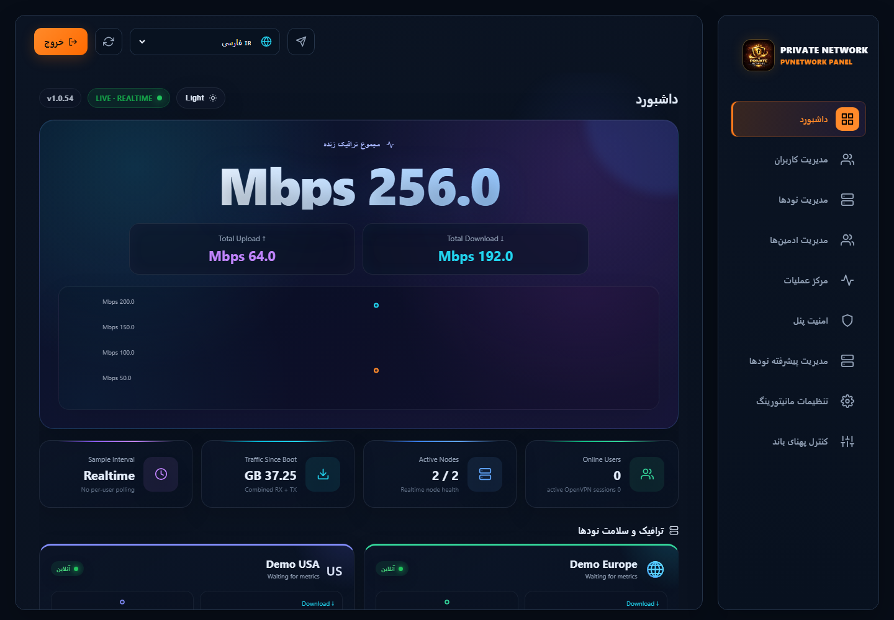
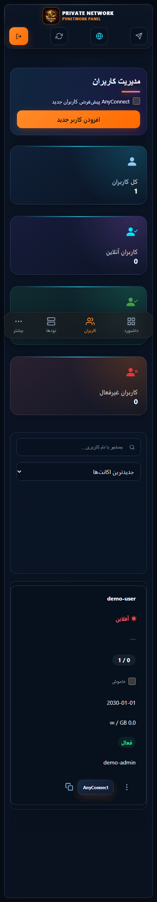

# PVNetwork

[English](README.md) · [راهنمای تصویری](docs/UI-GUIDE.fa.md) · [نصب](docs/INSTALLATION.fa.md) · [کنسول](docs/CLI.fa.md)

PVNetwork پنل مدیریت کاربران OpenVPN، اشتراک‌ها، نمایندگان و نودهاست. رابط وب چندزبانه و کنسول عملیاتی ۲۵بخشی فارسی و انگلیسی دارد. پنل سیاست حساب را مدیریت می‌کند و نودها اتصال VPN، مصرف و وضعیت نشست را ارائه می‌دهند.

## وضعیت انتشار و تغییرات

**نسخهٔ v1.0.59، QA عمومی بررسی‌شده و روی پنلِ مجاز فعال است — PVN-1044.** تغییر نسبت به QA58: خطای ساختاریافتهٔ نصب خودکار و ثبت دستی نود با نام ترجمه‌شدهٔ فیلد و پیام خوانا نمایش داده می‌شود؛ ورودی خام و context خطا وارد پیام نمی‌شوند. CI کد دقیق، دانلود ناشناس، نصب عمومی هر شش مهمان x86/ARM و استقرار پس از بکاپ قابل‌بازیابی پاس شدند. چهار بررسی واقعی رابط فارسی/انگلیسی، خوانایی پیام، فوکوس و پاک‌شدن رمز را تأیید کردند. [راهنمای تصویری فارسی](docs/NODE-VALIDATION-v1.0.59.fa.md) · [English](docs/NODE-VALIDATION-v1.0.59.md) · [شواهد تست](docs/VALIDATION-v1.0.59.md) · [شواهد استقرار](docs/PRODUCTION-v1.0.59.md) · [انتشار QA](https://github.com/DashSaman/OV-PvNetwork/releases/tag/v1.0.59). Stable پشتیبانی‌شده همچنان v1.0.37 است؛ آزمون مستقل نود/کلاینت بیرونی، ACME عمومی و ابزار کمکی واقعی باز هستند. [ایراد قدیمی مسیر اشتراک PVN-1045](docs/incidents/2026-10-19-subscription-template-contract.md).

**v1.0.58، QA عمومی بررسی‌شده است.** تغییرات نسبت به QA57: کنتراست واقعی تم و اسکرول، نام دسترس‌پذیر وزن نود و کنسول نصب با پاک‌کردن اطلاعات SSH و راهنمای تأیید میزبان. CI کد دقیق، 272 حالت کنتراست و نصب عمومی تازه/تکراری هر 6 مهمان x86/ARM پاس شدند. [راهنمای تصویری](docs/MANUAL-ACCESSIBILITY-v1.0.58.fa.md) · [English](docs/MANUAL-ACCESSIBILITY-v1.0.58.md) · [شواهد و شرط‌های باقی‌مانده](docs/VALIDATION-v1.0.58.md) · [انتشار QA](https://github.com/DashSaman/OV-PvNetwork/releases/tag/v1.0.58). در نقطهٔ QA58، پنلِ مجاز پس از بکاپ، canary و آمادگی rollback نسخهٔ v1.0.58 را اجرا می‌کرد؛ فعال‌سازی بعدی QA59 در بالا ثبت شده است. Stable پشتیبانی‌شده همچنان v1.0.37 است. [شواهد استقرار و یک محدودیت قدیمی متن خطا](docs/PRODUCTION-v1.0.58.md).

**نسخهٔ v1.0.57، QA عمومی بررسی‌شده است.** تغییر نسبت به v1.0.56: فوکوس/Escape/بازگشت دقیق پنجره‌ها، منوی کیبورد، برچسب‌ها، تیتر و لینک عبور به محتوا، اعلان خطا، کاهش حرکت و کنتراست تم روشن و منوها. CI دقیق، 228 اسکن axe و نصب عمومی هر شش مهمان x86/ARM پاس شدند. [راهنمای تصویری](docs/ACCESSIBILITY.fa.md) · [English guide](docs/ACCESSIBILITY.md) · [شواهد و gateهای Stable](docs/VALIDATION-v1.0.57.md) · [انتشار QA](https://github.com/DashSaman/OV-PvNetwork/releases/tag/v1.0.57). در نقطهٔ QA57، نسخهٔ زنده v1.0.55 بود؛ فعال‌سازی بعدی QA58 جدا ثبت شده است.

**نسخه v1.0.56، QA عمومی بررسی‌شده است.** تغییر نسبت به v1.0.55: گواهی جدیدِ نصب‌کننده، hook امن reload شدن Nginx پس از تمدید موفق دارد. CI دقیق، دانلود ناشناس آرشیو و نصب عمومی هر سه توزیع روی x86_64 و ARM64 واقعی پاس شدند. [شواهد و gateهای باقی‌مانده Stable](docs/VALIDATION-v1.0.56.md) · [یادداشت فارسی](docs/RELEASE-NOTES-v1.0.56.fa.md) · [English notes](docs/RELEASE-NOTES-v1.0.56.md). استقرار Production یا تغییر گواهی زنده انجام نشده است.

**نسخه v1.0.55، QA بررسی‌شده و روی پنلِ مجاز مستقر شده است.** CI دقیق، bootstrap عمومی سه توزیع، بکاپ/canary و کنترل‌های Production پاس شده‌اند. آخرین نسخه پایدار پشتیبانی‌شده تا عبور از gateهای گسترده‌تر همچنان v1.0.37 است. پیش از نصب یا ارتقا، [شواهد و محدودیت‌ها](docs/VALIDATION-v1.0.55.md) و یادداشت همان نسخه را بخوانید.

تغییر نسبت به v1.0.54: بکاپ native فقط فایل تشخیصیِ در حال نوشتن `data/app.log` را از آرشیو قابل‌بازیابی کنار می‌گذارد؛ کنترل ثبات کلیدها، اعتماد SSH و بقیه فایل‌ها حفظ می‌شود. لاگ روی سرور باقی می‌ماند. این اصلاح خطایی را رفع می‌کند که ارتقا را پیش از فعال‌سازی متوقف کرده بود. [یادداشت فارسی](docs/RELEASE-NOTES-v1.0.55.fa.md) · [English notes](docs/RELEASE-NOTES-v1.0.55.md).



گردش تصویری پایه ۸۰ تصویر ساختگی از v1.0.54 دارد که برای نسخه‌های 55–56 نیز کاربرد دارند. [راهنمای کیبورد v1.0.57](docs/ACCESSIBILITY.fa.md) چهار تصویر تازهٔ فارسی/انگلیسی و موبایل/دسکتاپ و تغییرات پنجرهٔ روشن را نشان می‌دهد. تصاویر اطلاعات مشتری/Production ندارند و اثبات سلامت سرویس واقعی نیستند.

## از اینجا شروع کنید

1. [پیش‌نیازها و روش دسترسی](docs/INSTALLATION.fa.md) را بخوانید. برای ارزیابی خصوصی Setup Mode و برای کنترل نود راه دور دامنه HTTPS واقعی انتخاب کنید.
2. روی سرور تازه و واجد شرایط نصب کنید، اطلاعات ورود اولیه را از فایل خصوصی بخوانید و `sudo pvnetwork doctor --json` را بررسی کنید.
3. [نود را اضافه کنید](docs/NODE-INSTALLATION.fa.md)؛ سپس طبق [آموزش کاربران](docs/UI-GUIDE.fa.md#2-users) حساب بسازید و پروفایل و صفحه اشتراک را دریافت کنید.
4. پیش از ارائه به مشتری، اتصال واقعی VPN و ثبت مصرف را روی نود آزمایشی خودتان بررسی کنید. سبز بودن پنل یا دانلود فایل به‌تنهایی اتصال تونل را ثابت نمی‌کند.
5. بکاپ خصوصیِ بررسی‌شده بگیرید و پیش از تغییر نصب موجود، [ارتقا و بازیابی](docs/UPDATES.md) را بخوانید.

فرمان زیر مخصوص **ارزیابی QA روی سرور تازه با assetهای تغییرناپذیر منتشرشده v1.0.59** است. نصب تازه را برای جایگزین کردن پنل موجود اجرا نکنید.

```bash
bash <(curl -fsSL https://raw.githubusercontent.com/DashSaman/OV-PvNetwork/v1.0.59/install.sh)
```

Bootstrap نسخه و checksum آرشیو رسمی را کنترل می‌کند، ابزار و build را جدا آماده می‌کند و پیش از فعال‌سازی سلامت را می‌سنجد. Setup Mode پیش‌فرض فقط روی loopback است؛ [راهنمای نصب](docs/INSTALLATION.fa.md) دسترسی SSH و TLS عمومی را توضیح می‌دهد.

برای نصب موجود، از `sudo pvnetwork update v1.0.59 --dry-run --json` و [راهنمای ارتقا/rollback بررسی‌شده](docs/UPDATES.fa.md) شروع کنید. نسخه هدف فقط پس از تأیید asset رسمی و gateهای لازم قابل استفاده است؛ Fresh Install عملیات متفاوتی است.

## آموزش بخش‌به‌بخش

| بخش | کاربرد | آموزش |
| --- | --- | --- |
| داشبورد | نرخ لحظه‌ای، شمارنده، حضور و سلامت نود | [مشاهده](docs/UI-GUIDE.fa.md#1-dashboard-and-navigation) |
| کاربران | ساخت، ویرایش سریع، تمدید، تخصیص نود، غیرفعال‌سازی و حذف | [مشاهده](docs/UI-GUIDE.fa.md#2-users) |
| پروفایل و اشتراک | دانلود هر نود، QR، کلاینت و AnyConnect | [مشاهده](docs/UI-GUIDE.fa.md#3-profiles-subscriptions-and-anyconnect) |
| نودها | نصب SSH، پذیرش صریح نود موجود، ثبت دستی و آرشیو | [مشاهده](docs/UI-GUIDE.fa.md#4-nodes) |
| نمایندگان | سهمیه و انتقال مالکیت حساب | [مشاهده](docs/UI-GUIDE.fa.md#5-admins-and-resellers) |
| مرکز عملیات | عملیات گروهی، انتقال ظرفیت، تاریخچه و توازن | [مشاهده](docs/UI-GUIDE.fa.md#6-operations-center) |
| امنیت | سیاست دسترسی، TOTP، توکن محدود و تنظیمات مرحله‌ای پنل | [مشاهده](docs/UI-GUIDE.fa.md#7-panel-security) |
| مدیریت پیشرفته نود | وضعیت نسخه و اجرای job محدود | [مشاهده](docs/UI-GUIDE.fa.md#8-advanced-node-management) |
| مانیتورینگ | آستانه‌ها و اعلان خصوصی Telegram | [مشاهده](docs/UI-GUIDE.fa.md#9-monitoring) |
| پهنای باند | پیش‌نمایش، canary و فعال‌سازی محدودیت اضطراری | [مشاهده](docs/UI-GUIDE.fa.md#10-bandwidth-control) |
| بکاپ | آرشیو خصوصی و بازیابی بررسی‌شده | [مشاهده](docs/UI-GUIDE.fa.md#11-panel-backup-and-restore) |
| کنسول | منوی ۲۵بخشی فارسی/انگلیسی و پیگیری job | [مشاهده](docs/CLI.fa.md) |



## رفتارهای مهم حساب

- سهمیه ترافیک صفر یعنی پلن نامحدود با دوره پایه ۳۰روزه؛ محدودیت دستگاه و سیاست نود همچنان اعمال می‌شود.
- تمدید UUID، نام و تخصیص نود را نگه می‌دارد. حالت مصرف را آگاهانه انتخاب کنید.
- تغییر نام امن از v1.0.16، پروفایل قدیمی OpenVPN را فوراً بی‌اعتبار می‌کند. پس از موفقیت تغییر نام، پروفایل تازه را به کاربر بدهید.
- حضور، وضعیت نشست گزارش‌شده است؛ مجموع ترافیک از زمان بوت، سرعت فعلی اتصال نیست.
- تعمیر، همگام‌سازی، حذف و rollback نود دامنه و کنترل متفاوت دارند. پذیرفته شدن job به معنی پایان موفق آن نیست.

## بررسی عملیاتی

```bash
sudo pvnetwork status --json
sudo pvnetwork doctor --json
sudo pvnetwork database check --json
sudo pvnetwork backup --json
sudo pvnetwork jobs --json
```

برای نسخهٔ دقیق v1.0.59، نصب تازه، تکراری و bootstrap عمومی هر سه توزیع در x86_64 و ARM64 واقعی تأیید شدند. پنل مجاز v1.0.59 را اجرا می‌کند؛ بازهٔ نگهداری مشاهده‌شدهٔ پنل 136.78 ثانیه بود. هویت کاربران و تخصیص‌ها، محیط، کلیدها، پیکربندی و PID سرویس‌های محافظت‌شده حفظ شدند. [دامنهٔ استقرار و بررسی واقعی رابط](docs/PRODUCTION-v1.0.59.md). آزمون مستقل نود/کلاینت بیرونی، ACME عمومی و ابزار کمکی واقعی باز هستند؛ پوشش پروندهٔ مهرشدهٔ امنیت کد۴۵ همچنان partial است و اصلاحات46/50 در59 حفظ شده‌اند. [پروندهٔ امنیت و محدودیت‌ها](docs/SECURITY-SCAN-CLOSURE.md).

## مستندات و امنیت

- [آموزش تصویری فارسی](docs/UI-GUIDE.fa.md) · [English manual](docs/UI-GUIDE.md)
- [نصب فارسی](docs/INSTALLATION.fa.md) · [نودها](docs/NODE-INSTALLATION.fa.md) · [کنسول](docs/CLI.fa.md)
- [سیاست امنیت](SECURITY.md) · [تغییرات](CHANGELOG.md)
- [نسخه‌ها](https://github.com/DashSaman/OV-PvNetwork/releases) · [دفتر کارها](AGENTS.md)

بکاپ، لینک اشتراک، پروفایل VPN، QR، توکن و گزارش پشتیبانی را خصوصی نگه دارید. برای گزارش آسیب‌پذیری [سیاست امنیت](SECURITY.md) را دنبال کنید. مقدارهای Demo و `.example.invalid` در آموزش، نمونه‌اند و باید به‌صورت خصوصی با تنظیمات خودتان جایگزین شوند.

## مجوز و منشأ سورس

[LICENSE](LICENSE)، [راهنمای سورس نود](node-agent/README.md)، `node-agent/LICENSE` و `manifest.json` مجوز و منشأ نسخه‌های استفاده‌شده را ثبت می‌کنند.
