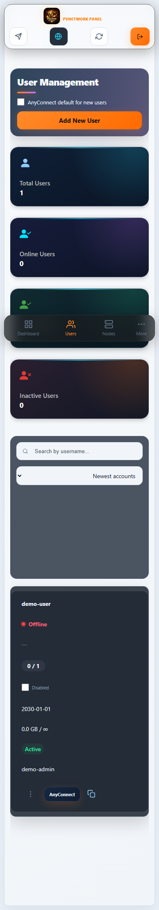

# PVNetwork

[فارسی](README.fa.md) · [Illustrated guide](docs/UI-GUIDE.md) · [Installation](docs/INSTALLATION.md) · [CLI](docs/CLI.md)

PVNetwork manages OpenVPN users, subscriptions, resellers and nodes from a multilingual web panel and a 25-item English/Persian operational console. The panel controls account policy; nodes provide VPN connectivity and report usage and session state.

## Release status and changes

**v1.0.55 is a QA candidate.** v1.0.54 is an immutable published prerelease; the last supported stable release remains v1.0.37. Read [validation evidence and limits](docs/VALIDATION-v1.0.54.md) and the target release notes before installing or updating.

Since v1.0.54: the native backup excludes only the panel's actively written diagnostic `data/app.log`; credential keys, SSH trust and other state retain their consistency checks. The log stays on the server. This resolves an update that stopped before activation. [English release notes](docs/RELEASE-NOTES-v1.0.55.md) · [تغییرات فارسی](docs/RELEASE-NOTES-v1.0.55.fa.md).


Screenshots show the current web interface using synthetic Demo data. They contain no customer or Production configuration and are not proof of live service health. v1.0.55 changes backup behavior only; its interface matches these v1.0.54 captures.

## Start here

1. Review the [fresh-server requirements and access modes](docs/INSTALLATION.md). Choose Setup Mode for private evaluation or a real HTTPS domain for a remote-node controller.
2. Install on an eligible fresh server, read the private initial credentials and verify `sudo pvnetwork doctor --json`.
3. Follow [node installation](docs/NODE-INSTALLATION.md), then [create a user, download a profile and open the subscription](docs/UI-GUIDE.md#2-users).
4. Test an actual VPN connection and usage accounting on your test node before serving customers. A green panel or a downloaded profile alone does not prove tunnel connectivity.
5. Make a verified private backup and read [updates and recovery](docs/UPDATES.md) before changes to an existing installation.

The version-pinned QA command below is for **fresh-server evaluation after the v1.0.55 release assets exist**. Do not use Fresh Install to replace an existing panel.

```bash
bash <(curl -fsSL https://raw.githubusercontent.com/DashSaman/OV-PvNetwork/v1.0.55/install.sh)
```

The bootstrap verifies the official archive checksum and version, stages private tools/builds and verifies health before activation. Default Setup Mode is loopback-only; [the installation guide](docs/INSTALLATION.md) explains SSH forwarding and public TLS.

## Learn each section

| Section | What you can do | Tutorial |
| --- | --- | --- |
| Dashboard | Inspect live rates, counters, presence and node health | [Open](docs/UI-GUIDE.md#1-dashboard-and-navigation) |
| Users | Create, quick edit, renew, assign nodes, disable and delete | [Open](docs/UI-GUIDE.md#2-users) |
| Profiles and subscriptions | Download per-node profiles, use QR/client links, manage AnyConnect | [Open](docs/UI-GUIDE.md#3-profiles-subscriptions-and-anyconnect) |
| Nodes | Automatic SSH deployment, explicit adoption, manual registration, archives | [Open](docs/UI-GUIDE.md#4-nodes) |
| Admins / resellers | Set capacity and transfer account ownership | [Open](docs/UI-GUIDE.md#5-admins-and-resellers) |
| Operations | Review selected bulk actions, capacity transfer, history and rebalance | [Open](docs/UI-GUIDE.md#6-operations-center) |
| Security | Set access policy, TOTP, scoped tokens and staged panel settings | [Open](docs/UI-GUIDE.md#7-panel-security) |
| Fleet | Inspect node mode/version and manage scoped jobs | [Open](docs/UI-GUIDE.md#8-advanced-node-management) |
| Monitoring | Configure thresholds and private Telegram notifications | [Open](docs/UI-GUIDE.md#9-monitoring) |
| Bandwidth | Preview, canary and activate an emergency limit | [Open](docs/UI-GUIDE.md#10-bandwidth-control) |
| Backups | Create private archives and follow verified restore/recovery | [Open](docs/UI-GUIDE.md#11-panel-backup-and-restore) |
| CLI | Operate the 25-item EN/FA console and inspect jobs | [Open](docs/CLI.md) |



## Account behavior to understand

- Zero traffic quota denotes an unlimited plan with a 30-day baseline period; explicit device and node policies still apply.
- Renewal retains the user's UUID, name and assignments. Choose the usage mode deliberately.
- Safe rename, introduced in v1.0.16, invalidates old OpenVPN profiles immediately. Download and distribute replacement profiles after a successful rename.
- Presence is reported session state; cumulative traffic since boot is not the current connection speed.
- Node repair/reconciliation, deletion and code rollback have distinct scopes and guards. A queued job must reach a verified terminal state before it counts as successful.

## Operations and verification

```bash
sudo pvnetwork status --json
sudo pvnetwork doctor --json
sudo pvnetwork database check --json
sudo pvnetwork backup --json
sudo pvnetwork jobs --json
```

Ubuntu 22.04/24.04 and Debian 12 have exact v1.0.54 native fresh/repeat/public-bootstrap evidence. Public ACME issuance, ARM and a separate empty external VPS are explicitly not fully validated in this mission. Final v1.0.55 CI, artifact and authorized deployment remain gates until recorded. The original security workbench is partial/unsealed; five validated findings were corrected in v1.0.46/v1.0.50. This README does not assert a completed independent security certification.

## Documentation and security

- [English illustrated manual](docs/UI-GUIDE.md) · [راهنمای تصویری فارسی](docs/UI-GUIDE.fa.md)
- [Fresh installation](docs/INSTALLATION.md) · [نصب فارسی](docs/INSTALLATION.fa.md)
- [Nodes](docs/NODE-INSTALLATION.md) · [نودها](docs/NODE-INSTALLATION.fa.md)
- [CLI English](docs/CLI.md) · [کنسول فارسی](docs/CLI.fa.md)
- [Security policy](SECURITY.md) · [Changelog](CHANGELOG.md)
- [Release history](https://github.com/DashSaman/OV-PvNetwork/releases) · [Task ledger](AGENTS.md)

Keep backups, subscription links, VPN profiles, QR codes, API tokens and support diagnostics private. Use the repository's [security policy](SECURITY.md) when reporting a vulnerability. Replace all `.example.invalid`/Demo values in the guides with your own configuration privately.

## License and provenance

See [LICENSE](LICENSE) and the [node source and upstream notice](node-agent/README.md). Native node source provenance and license notices are retained in `node-agent/LICENSE` and `manifest.json`.
