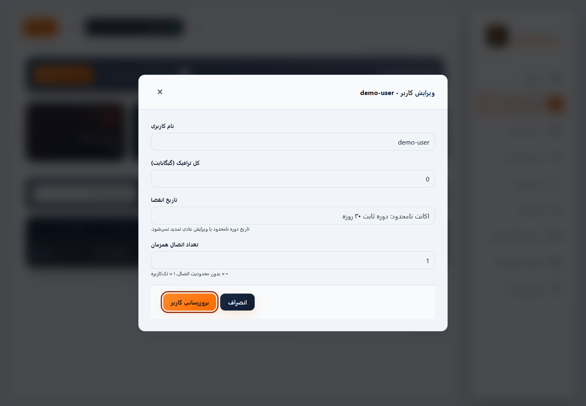
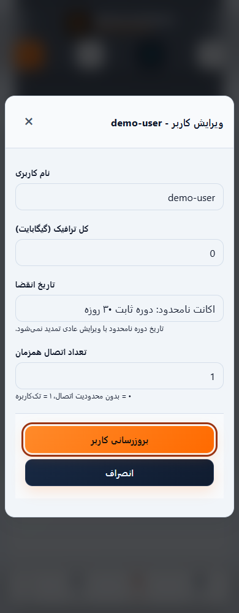

# راهنمای دسترس‌پذیری و کیبورد — PVN-1041

[English](ACCESSIBILITY.md) · [شواهد و محدودیت‌ها](VALIDATION-v1.0.57.md)

نسخهٔ کاندید 1.0.57 مسیرهای فعلی پنل، ورود و اشتراک را اصلاح می‌کند. رفتار API و مجوزهای دسترسی حفظ می‌شود. این تست‌های محدود، گواهی جامع WCAG یا جایگزین آزمون با صفحه‌خوان و ابزار واقعی نیستند.

1. پس از باز کردن صفحهٔ پنل **Tab** بزنید. اولین لینک، **رفتن به محتوای اصلی** است؛ با **Enter** فوکوس به محتوای همان صفحه منتقل می‌شود. هر صفحه تیتر اصلی ترجمه‌شده دارد.
2. منوی عملیات سطر را با **Enter** باز کنید. با **بالا/پایین** و **Home/End** جابه‌جا شوید و با **Enter** انتخاب کنید. **Escape** منو را می‌بندد و فوکوس را به دکمه برمی‌گرداند. منوی **بیشتر** موبایل همین رفتار را دارد. **Tab** از منو خارج می‌شود.
3. پنجرهٔ کاربر، نود، نماینده یا تنظیمات را باز کنید. فوکوس وارد پنجرهٔ نام‌دار می‌شود؛ **Tab/Shift+Tab** داخل آن می‌مانند. **Escape** پنجرهٔ قابل‌بستن را می‌بندد و فوکوس را برمی‌گرداند. محدودیت بستن تأییدهای مشغول حفظ شده است. کنترل‌های پس‌زمینه هنگام باز بودن پنجره غیرفعال‌اند.
4. فیلدها برچسب متصل دارند. خطاها، از جمله ورود ناموفق، نقش alert دارند. حلقهٔ فوکوس موقعیت کیبورد را نشان می‌دهد؛ سطح روشن حلقهٔ کهربایی تیره‌تر دارد و کنتراست اندازه‌گیری‌شدهٔ فوکوس باید حداقل ۳:۱ باشد. بخش‌های اسکرول‌شونده نیز فوکوس می‌گیرند.
5. تنظیم **کاهش حرکت** سیستم‌عامل، انیمیشن‌ها و transition طولانی را محدود می‌کند. رنگ متن فیلدها در هر دو تم مشخص است؛ متن ثانویهٔ تم روشن تیره‌تر و پس‌زمینهٔ ناوبری موبایل مات شده است.
6. در صفحهٔ اشتراک روی **QR** نود فوکوس کنید و **Enter** یا **Space** بزنید. فوکوس وارد پنجره می‌شود، داخل آن می‌ماند و پس از بستن برمی‌گردد. دستور قابل‌اسکرول لینوکس هم فوکوس کیبورد دارد. رفتار قبلی کپی و دانلود حفظ شده است.

تصاویر فقط دادهٔ ساختگی Demo محلی دارند. تصویر، اثبات نتیجهٔ صفحه‌خوان یا سلامت Production نیست.

تست مرورگر از axe-core نسخهٔ 4.14.0 با قواعد WCAG A/AA و 2.1/2.2 و best-practice استفاده می‌کند و هیچ قاعده‌ای خاموش نشده است. مسیر واقعی صفحه، جهت زبان، رفتار کیبورد و کاهش حرکت بررسی می‌شوند. یک فیلد عمداً بدون نام باید خطا بدهد تا فعال بودن اسکن ثابت شود؛ سپس حذف می‌شود. موارد `incomplete` برای بررسی دستی ثبت می‌شوند و پاس محسوب نمی‌شوند. ماتریس، خطاهای بازتولیدشده و gateهای باقی‌مانده در [گزارش اعتبارسنجی](VALIDATION-v1.0.57.md) آمده‌اند.
