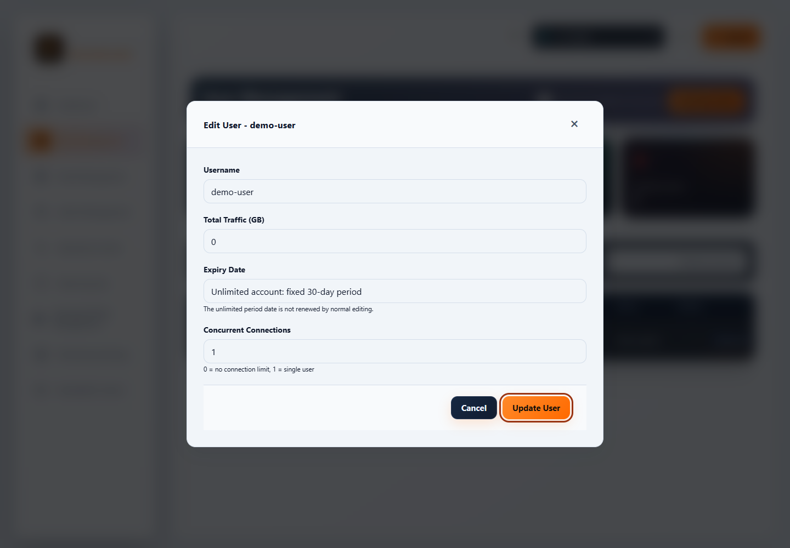
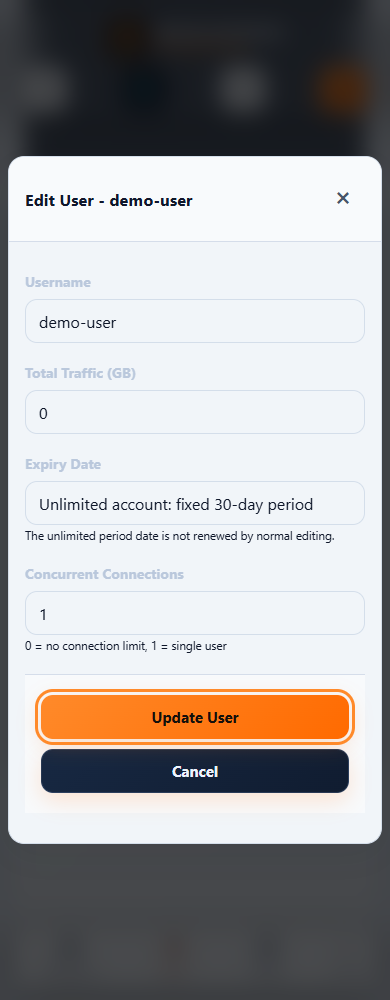

# Accessibility and keyboard guide — PVN-1041

[فارسی](ACCESSIBILITY.fa.md) · [Validation and limits](VALIDATION-v1.0.57.md)

The v1.0.57 QA release improves existing admin, login and subscription flows. It preserves their API and authorization behavior. These scoped automated tests do not certify complete WCAG conformance or replace testing with a screen reader and real assistive hardware.

1. Press **Tab** after opening an admin page. The first link, **Skip to main content**, bypasses navigation; press **Enter** to focus the current page's main content. Each page exposes its translated primary heading.
2. Open a row's actions menu with **Enter**. Use **Up/Down**, **Home/End**, then **Enter** to select an action. **Escape** closes the menu and returns focus to its button. The mobile **More** menu supports the same navigation. **Tab** leaves either menu.
3. Open a user, node, admin or settings dialog. Focus enters the named dialog. **Tab/Shift+Tab** stay inside; **Escape** closes an available dialog and returns focus to its invoker. Busy confirmations retain their existing close restrictions. Background controls are inert while the native dialog is open.
4. Fields expose associated labels. Error messages use alert semantics, including a rejected login. Use the visible focus ring to follow keyboard position. Light surfaces use a darker amber outline; measured focus contrast must reach3:1. Scrollable regions can receive focus for keyboard scrolling.
5. The operating system's **Reduce motion** preference suppresses animations and long transitions. Both themes retain explicit form colors; light theme uses darker secondary text and an opaque mobile navigation surface.
6. On a subscription page, focus a node's **QR** control and press **Enter** or **Space**. The QR dialog receives focus, contains keyboard navigation and returns focus when closed. The scrollable Linux command also accepts keyboard focus. Copy/download links retain their existing behavior.

Images contain only synthetic local Demo data. The screenshots illustrate focus and layout; they do not prove an assistive-technology or Production result.

The browser test runs axe-core 4.14.0 with WCAG A/AA, 2.1/2.2 and best-practice tags, without disabling rules. It asserts the actual route, language direction, keyboard behavior and reduced-motion state. A deliberately unnamed input must fail before the negative control is removed. `incomplete` results remain recorded as manual-review items; they are never counted as passes. See the exact matrix, observed failures and outstanding gates in [validation](VALIDATION-v1.0.57.md).

Implementation references: [W3C modal dialog pattern](https://www.w3.org/WAI/ARIA/apg/patterns/dialog-modal/), [native dialog technique H102](https://www.w3.org/WAI/WCAG22/Techniques/html/H102), [non-text/focus contrast](https://www.w3.org/WAI/WCAG22/understanding/non-text-contrast.html), [axe API](https://github.com/dequelabs/axe-core/blob/develop/doc/API.md).
