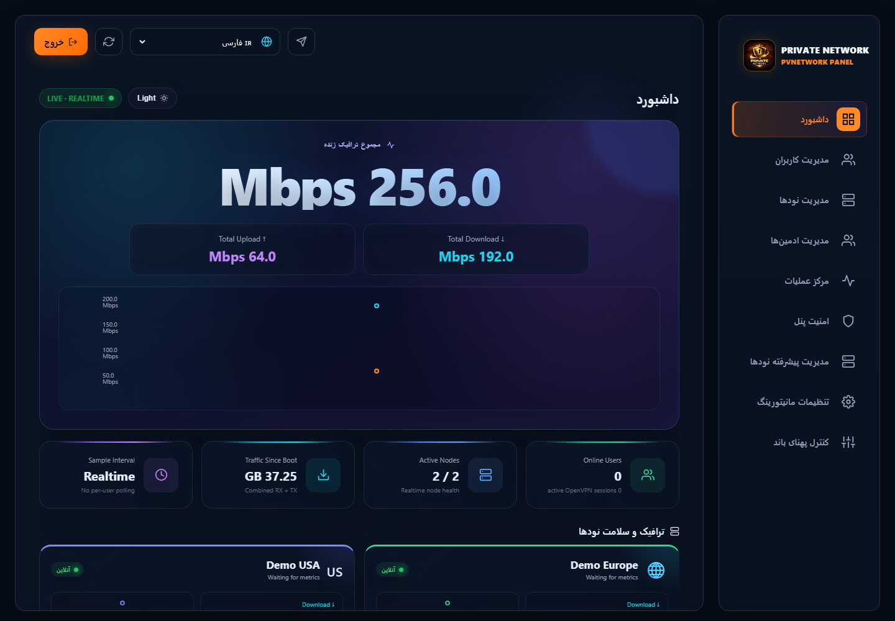
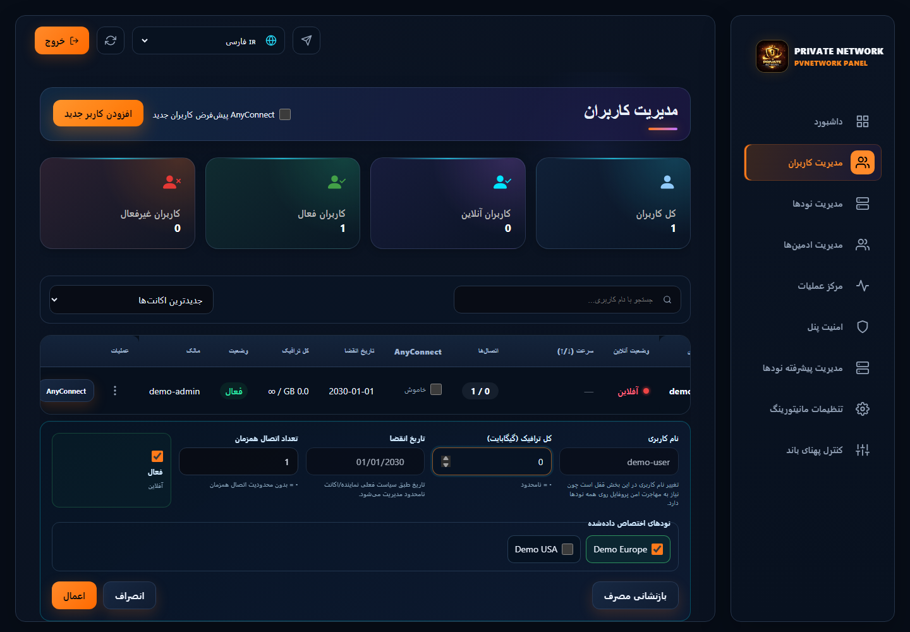
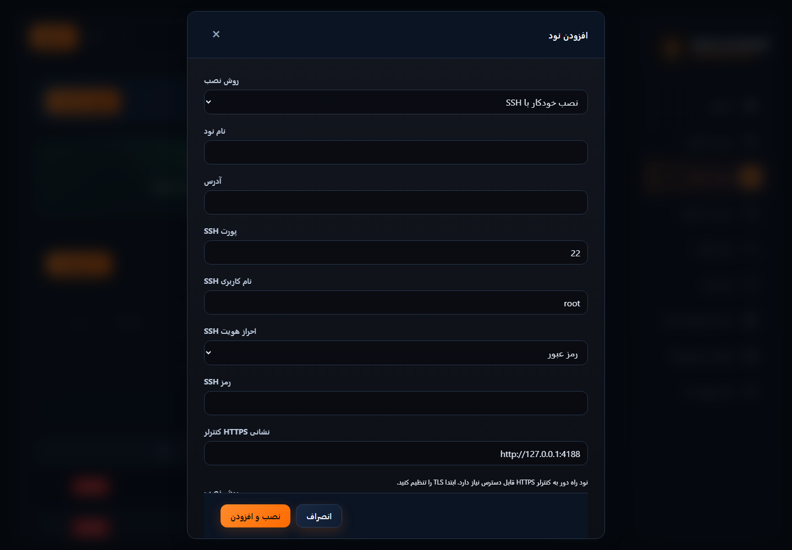

# راهنمای Demo نامزد ۱.۰.۵۰

این تصاویر از build فعلی با API ساختگی محلی ثبت شده‌اند؛ حساب، ترافیک، نشانی و اعتبارنامهٔ Production ندارند. فارسی با پوستهٔ تاریک و انگلیسی با پوستهٔ روشن، در عرض‌های ۳۹۰ و ۱۴۴۰ ثبت شده‌اند. تصویر Demo اثبات اجرای عملیات backend یا استقرار نیست. تصاویر نسخه‌های قدیمی در راهنماهای تاریخی با همان برچسب نسخه باقی می‌مانند.

| جریان | استفاده | دسکتاپ | موبایل |
| --- | --- | --- | --- |
| داشبورد | نرخ زنده، دسترسی نودها و وضعیت بکاپ و بازیابی را بررسی کنید. | [1440](images/v1.0.50/fa/desktop/dashboard.png) | [390](images/v1.0.50/fa/mobile/dashboard.png) |
| کاربران | حساب را پیدا کنید و سهمیه، انقضا، وضعیت و نودهای تخصیص‌یافته را ببینید. | [1440](images/v1.0.50/fa/desktop/users.png) | [390](images/v1.0.50/fa/mobile/users.png) |
| ساخت کاربر | پیش از ساخت، حجم، مدت، دستگاه‌ها و نودهای در دسترس را انتخاب کنید. | [1440](images/v1.0.50/fa/desktop/user-create.png) | [390](images/v1.0.50/fa/mobile/user-create.png) |
| ویرایش سریع | همان هویت را ویرایش کنید؛ در صورت نیاز صفرکردن مصرف را انتخاب و سپس اعمال یا لغو کنید. | [1440](images/v1.0.50/fa/desktop/quick-edit.png) | [390](images/v1.0.50/fa/mobile/quick-edit.png) |
| نودها | سلامت را ببینید و عملیات همان نود را انتخاب کنید؛ تخلیه، اتصال‌های فعلی را حفظ می‌کند. | [1440](images/v1.0.50/fa/desktop/nodes.png) | [390](images/v1.0.50/fa/mobile/nodes.png) |
| افزودن نود | SSH خودکار یا ثبت دستی را انتخاب کنید و اثر انگشت SSH را مستقل تأیید کنید. نصب تازه و پذیرش صریح نود موجود پیش‌شرط‌های متفاوت دارند. | [1440](images/v1.0.50/fa/desktop/node-create.png) | [390](images/v1.0.50/fa/mobile/node-create.png) |
| مدیران | محدودیت فروشنده را ببینید و فقط مدیر مورد نظر را مدیریت کنید. | [1440](images/v1.0.50/fa/desktop/admins.png) | [390](images/v1.0.50/fa/mobile/admins.png) |
| عملیات | پیش از عملیات گروهی یا انتقال مالکیت کاربران مورد نظر را انتخاب و نتیجه و گزارش را بررسی کنید. | [1440](images/v1.0.50/fa/desktop/operations.png) | [390](images/v1.0.50/fa/mobile/operations.png) |
| امنیت | سیاست نرخ و IP و 2FA را بررسی کنید. کد بازیابی را خصوصی نگه دارید و به توکن API فقط مجوز لازم بدهید. تغییر تنظیمات پنل یا اعتبارنامه به رمز فعلی و نتیجهٔ تأییدشده نیاز دارد. | [1440](images/v1.0.50/fa/desktop/security.png) | [390](images/v1.0.50/fa/mobile/security.png) |
| مدیریت پیشرفته نودها | نودهای هدف و اعتماد SSH را بررسی کنید و پیش از تغییر گسترده نتیجهٔ کاناری و job را دنبال کنید. | [1440](images/v1.0.50/fa/desktop/fleet.png) | [390](images/v1.0.50/fa/mobile/fleet.png) |
| مانیتورینگ | آستانه‌ها و اعلان خصوصی را تنظیم و مقصد تنظیم‌شده را آزمایش کنید. | [1440](images/v1.0.50/fa/desktop/monitoring.png) | [390](images/v1.0.50/fa/mobile/monitoring.png) |
| پهنای باند | پیش از فعال‌سازی، پیش‌نمایش سیاست و اهداف انتخاب‌شده را بررسی کنید. | [1440](images/v1.0.50/fa/desktop/bandwidth.png) | [390](images/v1.0.50/fa/mobile/bandwidth.png) |

برای نصب، بروزرسانی و بازیابی از [راهنمای نصب](INSTALLER-CANDIDATE.md)، [چرخهٔ نسخه](LIFECYCLE-CANDIDATE.md)، [نود](NODE-CANDIDATE.md)، [بکاپ نود](NODE-ARCHIVES-CANDIDATE.md) و [CLI فارسی](CLI.fa.md) استفاده کنید. نتیجهٔ job باید نهایی و موفق باشد؛ پذیرش درخواست به‌تنهایی موفقیت نیست.

اعتبارسنجی مستقل چیدمان: ۱۳ زبان، دو پوسته، نه عرض و سه زوم بومی = ۶۳۱۸ نما روی نامزد ۱.۰.۴۷؛ ویرایش سریع روی build ۱.۰.۵۰ در ۱۰۸ حالت پاس شد. این نتایج تأیید کامل ترجمه، کنتراست یا همهٔ فناوری‌های کمکی نیستند. بررسی نهایی انتشار باز است.
