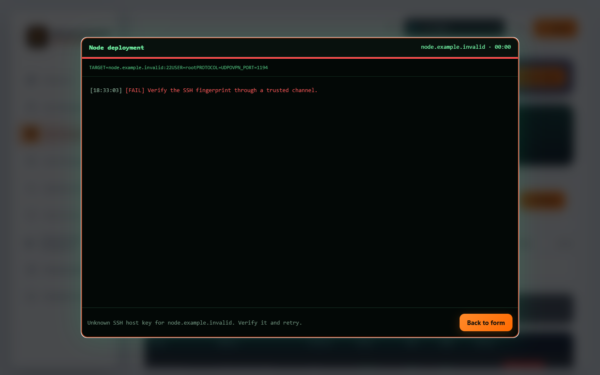
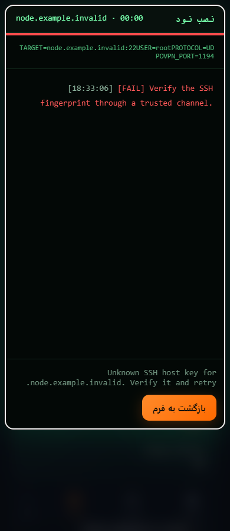

# کنتراست واقعی و نصب نود — نامزد v1.0.58

[English](MANUAL-ACCESSIBILITY-v1.0.58.md) · [شواهد و محدودیت‌ها](VALIDATION-v1.0.58.md) · [راهنمای صفحه‌کلید](ACCESSIBILITY.fa.md)

این نامزد، بررسی‌های دستی باقی‌مانده از QA57 را ادامه می‌دهد. هنوز انتشار عمومی یا فعال‌سازی رابط روی Production انجام نشده است.

۱. تم روشن و تیره را جابه‌جا کنید. رنگ متن ناوبری، سلامت نود، برچسب نمودار و مرز فیلدها با سطح واقعی آن‌ها هماهنگ شده است. سربرگ ثابت موبایل پس‌زمینهٔ غیرشفاف دارد تا محتوای در حال اسکرول، خوانایی آن را تغییر ندهد. خطوط دانلود و آپلود نمودار با الگوی خط متفاوت نیز مشخص می‌شوند.

۲. به بخش بکاپ پایین داشبورد و جدول سلامت نودهای دارای داده بروید. عنوان، هشدار و ردیف‌های بکاپ در تم روشن خوانا هستند. ورودی وزن هر نود، نام دسترس‌پذیر ترجمه‌شده و شامل نام همان نود دارد. برای حرکت افقی جدول با صفحه‌کلید، روی ناحیهٔ اسکرول جدول فوکوس کنید.

۳. در **نودها ← افزودن نود**، روش مناسب وضعیت واقعی سرور را انتخاب کنید. نصب سرور خالی با اتصال نود موجود متفاوت است. نام نود موجود را حفظ کنید، چون بخشی از هویت گواهی کلاینت‌هاست. [بازیابی پس از تغییر آدرس](incidents/2026-10-18-node-address-change.fa.md).

۴. در نخستین اتصال SSH، اثر انگشت را در کنسول معتبر ارائه‌دهنده یا مسیر احرازهویت‌شده بررسی کنید و سپس در فیلد مربوط وارد کنید. راهنمای متصل به فیلد این موضوع را توضیح می‌دهد. اثر انگشت نمایش‌داده‌شده در خطا خودکار پذیرفته یا در فیلد کپی نمی‌شود.

۵. پس از ارسال نصب خودکار، فوکوس داخل دیالوگ استاندارد و نام‌دار نتیجهٔ نصب می‌ماند. گزارش پیشرفت معنای log دارد و شکست به‌صورت alert اعلام می‌شود. **بازگشت به فرم**، فرم قابل استفاده‌ای باز می‌کند که اطلاعات SSH آن پاک شده‌اند؛ شکست HTTP هم این اطلاعات را پاک می‌کند. محدودیت بستن عملیات در حال اجرا حفظ شده است. پایان عملیات با صفحه‌کلید قابل بستن است و فوکوس به دکمهٔ آغازکننده برمی‌گردد.

۶. در بزرگ‌نمایی ۴۰۰٪، کنسول اسکرول عمودی دارد تا دکمهٔ پایانی قابل دسترسی بماند. فاصله‌گذاری متن WCAG نیز در تست اعمال می‌شود. شبیه‌سازی رنگ اجباری مرورگر، رنگ سیستم، مرز دکمه و فوکوس را حفظ می‌کند. این بررسی‌ها و تصاویر آزمایشی جای تست با صفحه‌خوان، کنترل گفتاری یا سخت‌افزار واقعی سیستم‌عامل را نمی‌گیرند.

تمام تصاویر از دادهٔ ساختگی در پیش‌نمایش محلی گرفته شده‌اند. اطلاعات مشتری یا دسترسی سرور واقعی در آن‌ها وجود ندارد. تصاویر وضعیت رابط را نشان می‌دهند و اثبات نصب واقعی روی VPS تازه نیستند.

بخش نام فایل و دکمهٔ **انتخاب فایل** رنگ صریح متناسب با تم دارند. رنگ متن و پس‌زمینهٔ غیرشفاف آن‌ها جدا از متن معمولی بررسی می‌شود؛ نحوهٔ نقاشی کنترل بومی مرورگر و پنجرهٔ انتخاب فایل سیستم‌عامل همچنان جزو بررسی دستی است.
