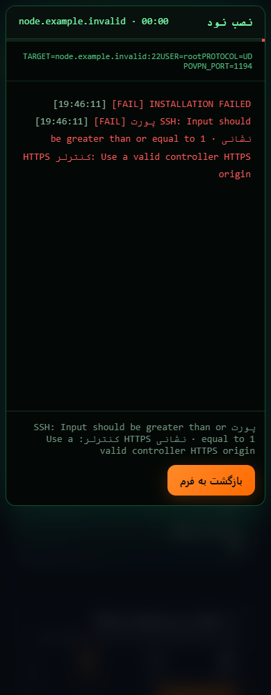

# v1.0.59 — خطای خوانای نصب نود

تغییر نسبت به QA58: درخواست نامعتبر نصب نود به‌جای `[object Object]`، نام فیلد و پیام آن را نشان می‌دهد. نصب خودکار SSH و ثبت دستی هر دو پوشش داده شده‌اند. ورودی خام و context خطا نمایش داده نمی‌شوند؛ بک‌اند نیز مقادیر حساس ارسال‌شده را از پیام اعتبارسنجی حذف می‌کند.

1. از **مدیریت نودها ← افزودن نود**، روش نصب و اطلاعات نود موردنظر را وارد کنید.
2. پس از ارسال، اگر اعتبارسنجی رد شد، پیام هر فیلد را در هشدار و لاگ کنسول بخوانید. خطای ثبت دستی داخل فرم نمایش داده می‌شود.
3. در نصب خودکار **بازگشت به فرم** را بزنید؛ فیلد نام‌برده را اصلاح و اطلاعات SSH را دوباره وارد کنید. اطلاعات حساس SSH پس از ارسال پاک می‌شوند.
4. اثر انگشت SSH جدید را از راه مستقل بررسی کنید و بعد وارد کنید. کلید دیده‌شده در خطا خودکار مورد اعتماد قرار نمی‌گیرد.
5. پس از اطمینان از سرور و حالت نصب صحیح دوباره ارسال کنید. رد اعتبارسنجی، job نصب نمی‌سازد و اثبات اتصال VPN نیست.

تصویر از محیط Demo جدا و آدرس نمونه است و اطلاعات نود زنده یا کاربر ندارد. فوکوس کیبورد دیالوگ بومی، Escape و بازگشت، تم روشن/تیره، RTL/LTR و زوم مرورگر در تست‌های رگرسیون بررسی می‌شوند؛ آزمون ابزار کمکی واقعی جدا باقی می‌ماند.

[English](NODE-VALIDATION-v1.0.59.md) · [راهنمای کامل نود](NODE-INSTALLATION.fa.md) · [شواهد و شرط‌های باقی‌مانده](VALIDATION-v1.0.59.md)
