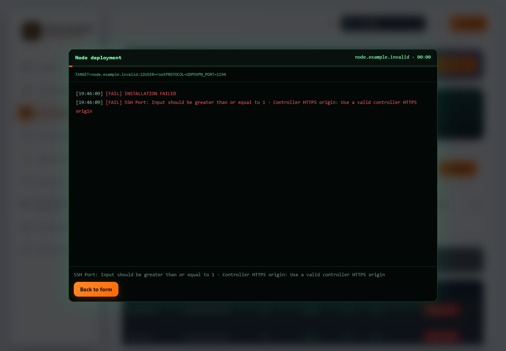

# v1.0.59 — readable node-install errors

Since QA58, a rejected node request shows the affected field and its message instead of `[object Object]`. This applies to automatic SSH installation and manual registration. Validation input/context is excluded; the backend still redacts submitted sensitive values from public validation messages.

1. Open **Nodes → Add node**, choose the installation method and enter the intended node details.
2. Submit. If validation fails, read each field message in the deployment alert/log; manual registration shows the alert in the form.
3. Select **Back to form** after automatic failure. Correct the named fields and enter SSH credentials again; submitted SSH secrets are cleared.
4. Verify a new SSH fingerprint independently before entering it. An observed key in an error is never accepted automatically.
5. Retry only with the correct intended server and installation mode. A validation rejection does not create an installation job or prove VPN connectivity.

The image uses isolated Demo fixtures and reserved example addresses. It contains no live node or customer information. Native dialog keyboard focus, Escape/back navigation, dark/light themes, RTL/LTR and browser zoom are covered by the regression gates; hardware assistive-technology testing remains separate.

[فارسی](NODE-VALIDATION-v1.0.59.fa.md) · [Complete node guide](NODE-INSTALLATION.md) · [Evidence and open release gates](VALIDATION-v1.0.59.md)
