# راهنمای تصویری و عملیاتی PVNetwork

[English](UI-GUIDE.md) · [README فارسی](../README.fa.md) · [نصب](INSTALLATION.fa.md) · [کنسول](CLI.fa.md)

این راهنما رابط فعلی v1.0.54 را آموزش می‌دهد که در v1.0.55 نیز یکسان است. تمام تصاویر با داده ساختگی Demo تهیه شده‌اند: انگلیسی/روشن و فارسی/تیره، دسکتاپ و موبایل. دکمه‌ها در نصب واقعی شما می‌توانند وضعیت سرویس را تغییر دهند؛ هنگام تهیه این تصاویر هیچ استقرار، اعلان یا تغییر اطلاعات مشتری انجام نشده است. بخش‌های مدیر اصلی ممکن است برای نماینده نمایش داده نشوند.

## ۱. داشبورد و جابه‌جایی بین صفحات

1. از مسیر اعلام‌شده پس از نصب وارد شوید. در موبایل از دکمه منو/ناوبری برای انتخاب صفحه استفاده کنید.
2. زبان و تم را از بالای صفحه انتخاب کنید. Refresh را بزنید و پیش از تفسیر نرخ، برای چند نمونه متوالی صبر کنید.
3. **ترافیک لحظه‌ای** نرخ دانلود و آپلود حاصل از اختلاف شمارنده‌هاست. **ترافیک از زمان بوت** مجموع بایت است، نه Mbps. نبود نرخ در اولین نمونه، صفر بودن مجموع مصرف را ثابت نمی‌کند.
4. حضور کاربران/نشست‌ها را همراه دسترس‌پذیری، CPU، RAM، زمان کار و ترافیک هر نود بررسی کنید. پیش از تخصیص جدید، نود آفلاین یا داده قدیمی را بررسی کنید.
5. برای بکاپ پنل به قسمت پایین داشبورد بروید. پیش از Restore بخش بکاپ همین راهنما را بخوانید.

نتیجه مورد انتظار: نمونه‌های تازه و نودهای قابل‌دسترسی با موجودی شما سازگار باشند. خطای API یا نمونه قدیمی به‌تنهایی توقف VPN را ثابت نمی‌کند.

[نمای موبایل](images/v1.0.54/fa/mobile/dashboard.png)

## ۲. کاربران

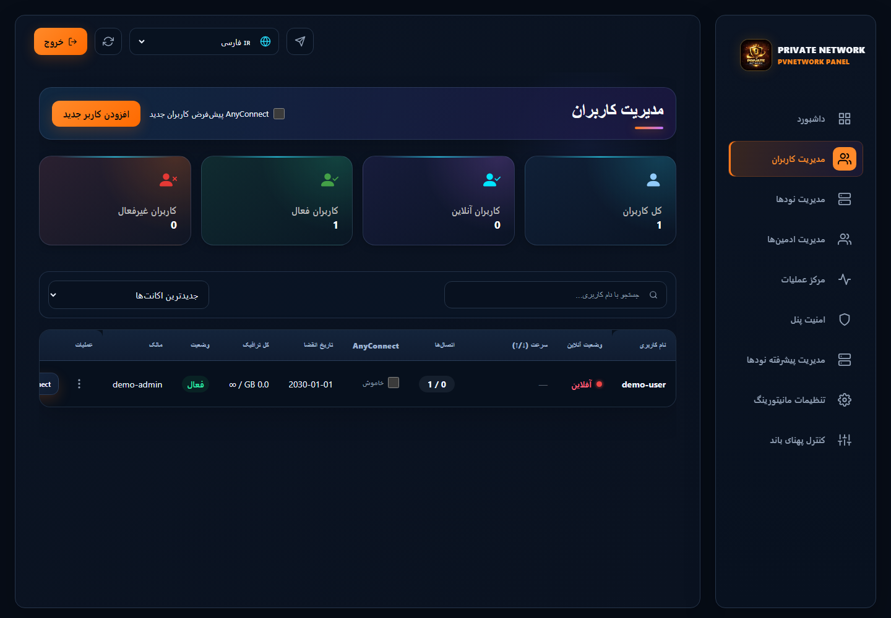

### ساخت حساب

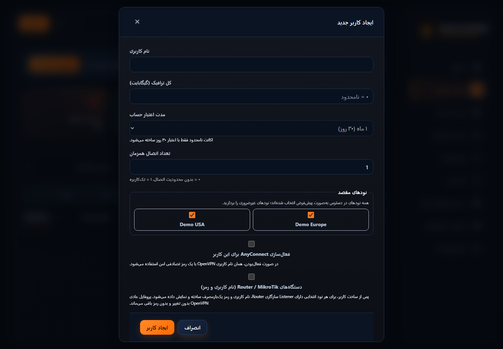

1. **مدیریت کاربران ← افزودن کاربر جدید** را باز کنید و نام، سهمیه ترافیک، مدت و محدودیت اتصال هم‌زمان را بنویسید.
2. سهمیه ترافیک **۰** یعنی نامحدود و دوره پایه آن ۳۰ روز است. نامحدود را به معنی بی‌انقضا یا بدون محدودیت دستگاه فرض نکنید.
3. **نودهای مقصد** را بررسی کنید. نودهای در دسترس ابتدا انتخاب می‌شوند؛ موارد ناخواسته را بردارید. نود آفلاین، در حال تخلیه یا تعمیر ممکن است دیده شود اما برای تخصیص تازه قابل انتخاب نیست.
4. AnyConnect یا Router/MikroTik را فقط در صورت نیاز و آماده بودن سرویس مربوط فعال کنید. یک بار ثبت کنید و منتظر نتیجه بمانید.
5. حساب را جست‌وجو و سهمیه، انقضا، وضعیت و تخصیص را کنترل کنید. در خطای provisioning، پیش از ارسال مجدد حساب و job را بررسی کنید.

### ویرایش سریع، ویرایش کامل و ریست

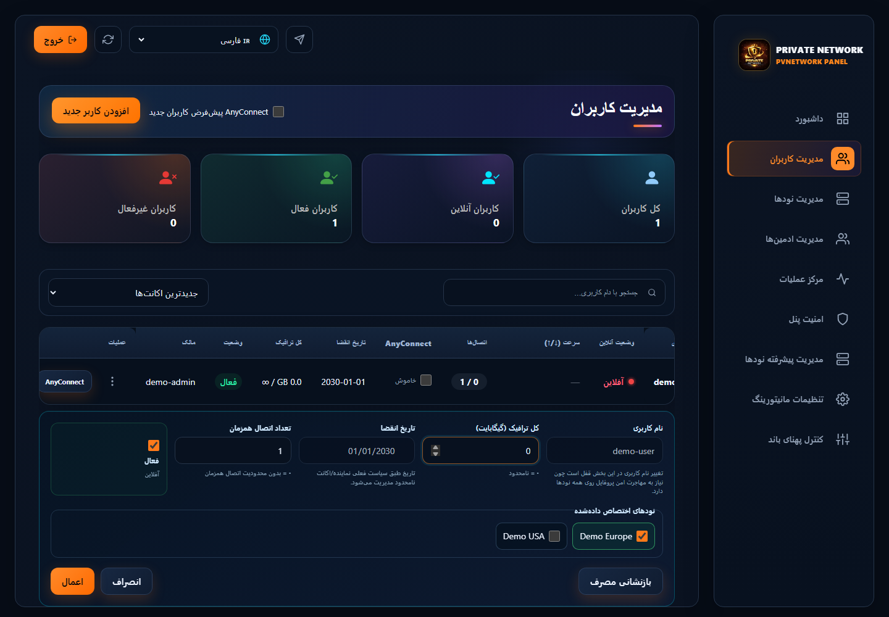

1. از منوی عملیات حساب، **ویرایش سریع** را انتخاب کنید. در موبایل ویرایشگر تمام‌عرض زیر جدول باز می‌شود؛ برای رسیدن به کنترل‌ها اسکرول کنید.
2. ترافیک، انقضا در صورت مجاز بودن، تعداد اتصال، وضعیت یا نودها را تغییر دهید. **ریست مصرف** را فقط با قصد ریست انتخاب کنید؛ ریست پلن نامحدود دوره ۳۰روزه تازه شروع می‌کند.
3. **اعمال** تغییرات را ثبت می‌کند و **انصراف** فرم باز را کنار می‌گذارد. پس از پایان ردیف نتیجه را دوباره بخوانید.
4. برای تغییر نام از روند کامل ویرایش/rename استفاده کنید. UUID حفظ می‌شود اما پروفایل قبلی فوراً نامعتبر می‌شود؛ فایل تازه بگیرید. اگر `cleanup_pending` دیدید، پاک‌سازی باقی‌مانده را بررسی کنید و rename را بی‌دلیل تکرار نکنید.

حذف تخصیص یک نود، پروفایل همان نود را غیرفعال می‌کند و با حذف کاربر متفاوت است. نود تازه انتخاب‌شده اگر در دسترس نباشد پیش از تغییر رد می‌شود.

### تمدید، غیرفعال‌سازی و حذف

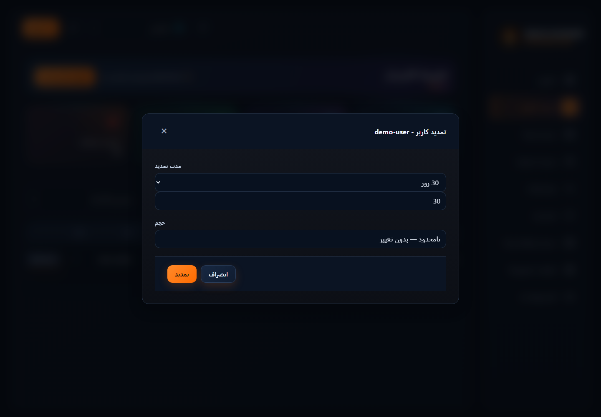

1. **تمدید** را بزنید و مدت و حالت ترافیک را بررسی کنید: حفظ مصرف، ریست مصرف یا افزودن ترافیک در صورت پشتیبانی.
2. یک بار ثبت کنید. تمدید UUID، نام و تخصیص‌ها را نگه می‌دارد و حساب منقضی می‌تواند فعال و همگام شود.
3. برای تعلیق، همان کاربر را غیرفعال و نتیجه را بررسی کنید. هدف و ادامه کار کاربران دیگر را کنترل کنید.
4. پیش از حذف، هویت و تخصیص‌ها را بخوانید. حذف با تعلیق قابل بازگشت فرق دارد؛ برای توقف موقت از غیرفعال‌سازی استفاده کنید.

### تاریخچه دامنه

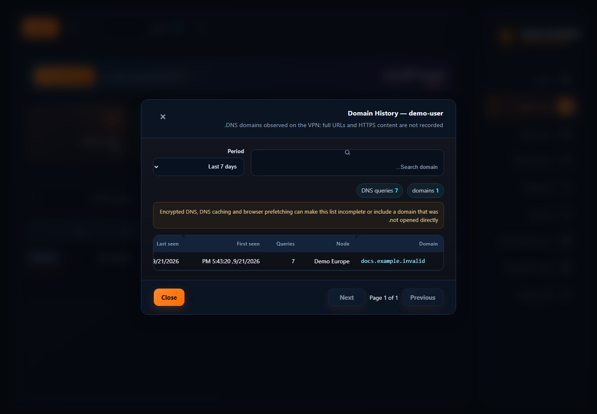

1. با حساب مدیر اصلی، **Domain History** را از منوی کاربر باز کنید.
2. بازه، فیلتر و صفحه را انتخاب و نود، زمان و تعداد ثبت را مقایسه کنید.
3. این صفحه فقط داده ثبت‌شده را نشان می‌دهد؛ تاریخچه کامل ترافیک یا محتوای HTTPS نیست. جدول خالی ممکن است به معنی نبود رکورد در بازه باشد.

[موبایل: کاربران](images/v1.0.54/fa/mobile/users.png) · [ساخت](images/v1.0.54/fa/mobile/user-create.png) · [ویرایش سریع](images/v1.0.54/fa/mobile/quick-edit.png) · [تمدید](images/v1.0.54/fa/mobile/user-renew.png) · [تاریخچه](images/v1.0.54/fa/mobile/domain-history.png)

## ۳. پروفایل، اشتراک و AnyConnect

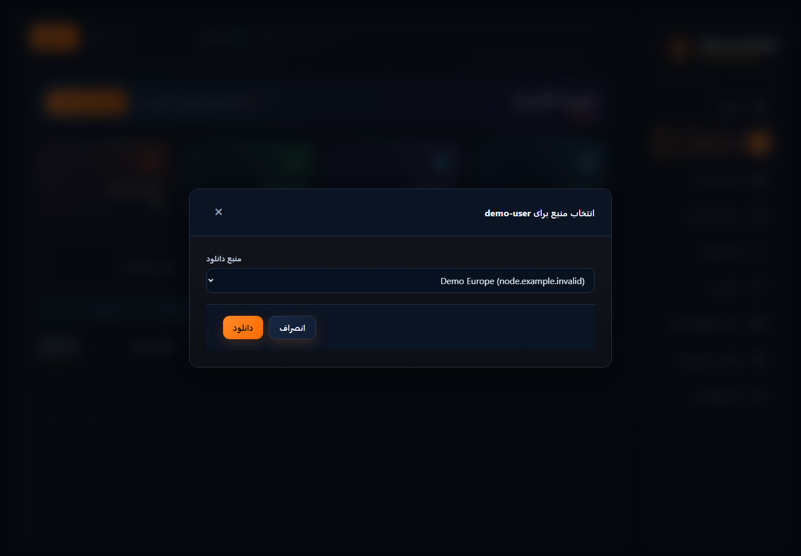

1. **دانلود** را برای کاربر موردنظر باز و نود را بررسی کنید. نود پیش‌فرض بدون انتخاب دوباره قابل دانلود است؛ تغییر انتخاب، پروفایل همان نود را می‌گیرد.
2. فایل `.ovpn` را خصوصی ذخیره و در کلاینت سازگار OpenVPN وارد کنید. اتصال TLS/TUN و عبور ترافیک واقعی را بررسی و سپس مصرف و حضور را در پنل کنترل کنید.
3. با **کپی لینک** صفحه اشتراک همان کاربر را باز کنید. لینک، QR و پروفایل اطلاعات دسترسی دارند؛ فقط به صاحب حساب بدهید.
4. در اشتراک، وضعیت، مصرف، انقضا و تعداد دستگاه را ببینید و نود تخصیص‌یافته و در دسترس را انتخاب کنید. راهنمای کلاینت/ورود اطلاعات همان پلتفرم را دنبال کنید. برای QR با کیبورد از فوکوس و Enter/Space استفاده کنید.
5. نصب PWA یا اعلان را اگر مرورگر ارائه می‌کند فقط روی دستگاه مورداعتماد فعال کنید. وجود این کنترل‌ها به HTTPS، مجوز مرورگر و پلتفرم هم بستگی دارد.

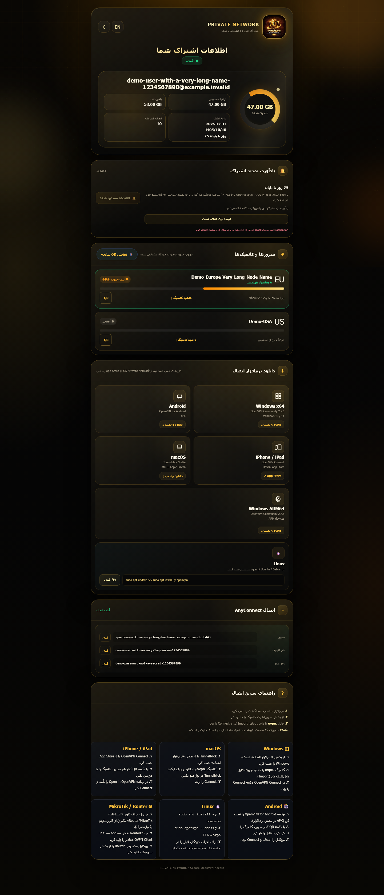

اطلاعات AnyConnect تصویر، ساختگی و صریحاً Demo است؛ صفحه واقعی شما خصوصی است. برچسب پیشنهادی/آنلاین راهنمای انتخاب است و مسیر اتصال ISP شما را ثابت نمی‌کند.

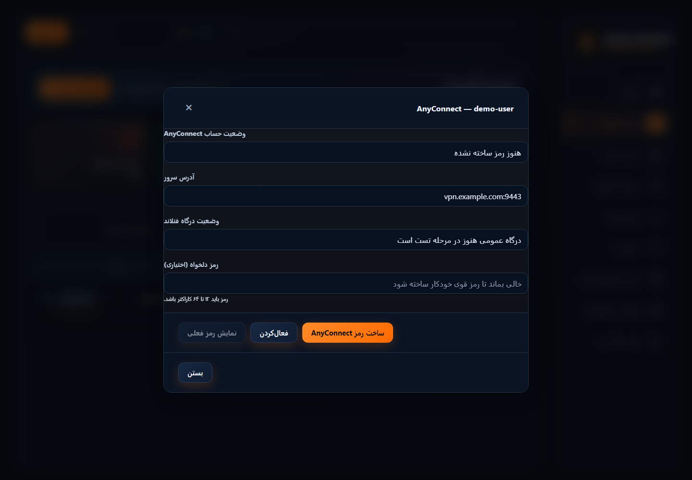

1. AnyConnect را برای همان کاربر باز و سرور و وضعیت حساب را بررسی کنید.
2. فقط در صورت نیاز حساب را فعال یا رمز را تولید/تغییر دهید. نمایش رمز فعلی اقدام صریح جدا دارد.
3. اطلاعات را خصوصی انتقال دهید و سرویس سازگار AnyConnect را جدا تست کنید. باز کردن این فرم، سرور VPN دلخواه خارجی نصب نمی‌کند.

Router/MikroTik اختیاری است. آن را هنگام ساخت/تنظیم حساب انتخاب کنید، نود سازگار تخصیص دهید و پروفایل مناسب را وارد روتر کنید. پیش از تغییر شبکه فعال، پروتکل، cipher، route و عبور ترافیک را روی روتر آزمایشی بسنجید.

[موبایل: دانلود](images/v1.0.54/fa/mobile/profile-download.png) · [اشتراک](images/v1.0.54/fa/mobile/subscription.png) · [AnyConnect](images/v1.0.54/fa/mobile/anyconnect.png)

## ۴. نودها

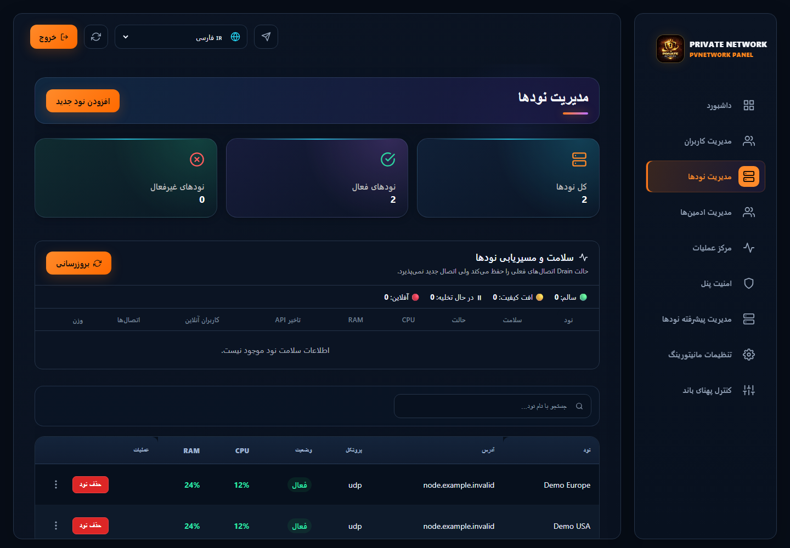

1. **مدیریت نودها** را باز و موجودی، آدرس، وضعیت فعال و سلامت را بررسی کنید. اگر داده قدیمی است، سلامت را جدا Refresh کنید.
2. برای افزودن میزبان از [آموزش نصب نود](NODE-INSTALLATION.fa.md) استفاده و آگاهانه fresh، پذیرش صریح موجود یا ثبت دستی را انتخاب کنید.
3. پس از پذیرفته شدن استقرار، job را تا پایان تأییدشده دنبال کنید. سلامت HTTPS احرازهویت‌شده و ثبت نود را ببینید؛ سپس با کاربر تست، پروفایل و ترافیک واقعی VPN را بررسی کنید.
4. پیش از تعمیر در صورت نیاز drain کنید؛ این کار تخصیص تازه را متوقف می‌کند و به معنی پایان نشست‌های فعلی نیست. همگام‌سازی/تعمیر فقط همان نود ثبت‌شده را هدف می‌گیرد و تخصیص‌ها را حفظ می‌کند.
5. پیش از حذف، کاربران و ظرفیت را بررسی کنید. کنترل آخرین نود/تخصیص می‌تواند درخواست را رد کند. به‌جای حذف نود زنده برای دور زدن خطا، انتقال تخصیص را از روند مشخص انجام دهید.

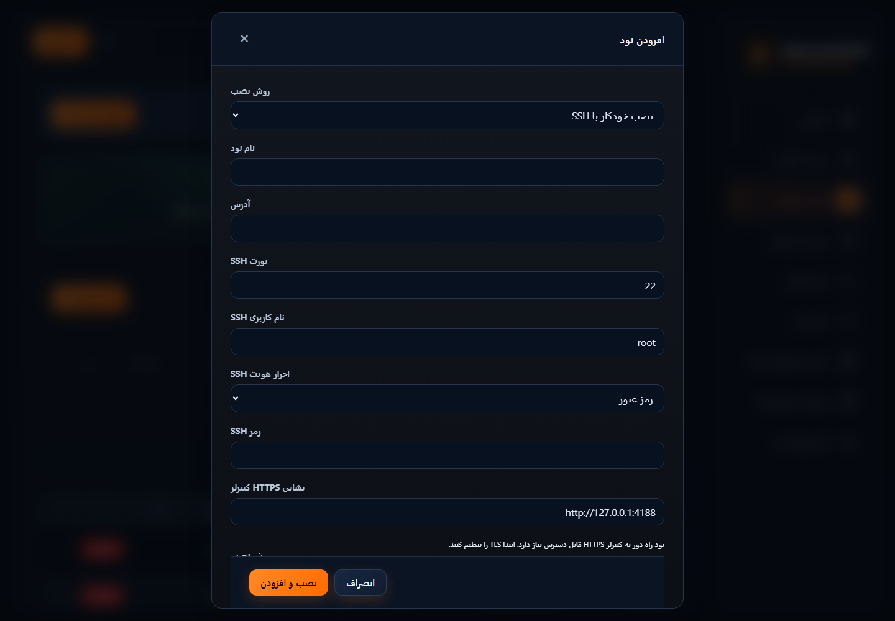

### آرشیو نود

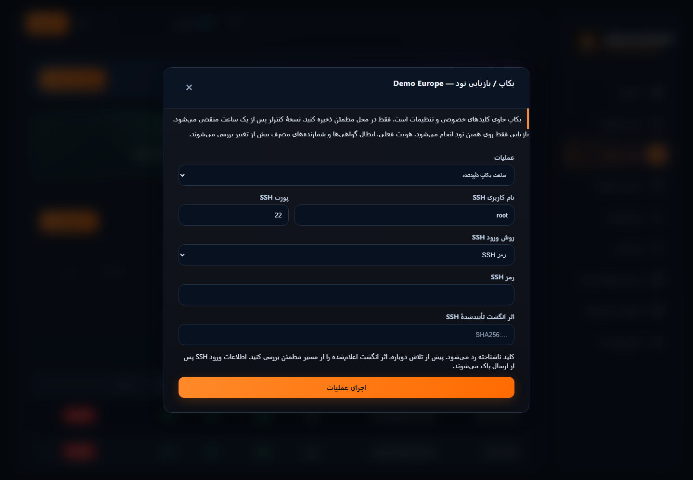

1. **بکاپ / بازیابی نود** را برای نود درست باز و عملیات دقیق را انتخاب کنید.
2. احراز هویت خصوصی و اعتماد SSH مستقل بررسی‌شده بدهید. برای Restore، پیش‌نیاز [آرشیو و recovery](NODE-ARCHIVES-CANDIDATE.fa.md) را بخوانید.
3. یک بار اجرا و آرشیو خصوصی و شناسه job را نگه دارید. نتیجه نهایی، هویت نود و سلامت VPN/حسابداری را بررسی کنید. بکاپ پنل با آرشیو نود پوشش متفاوت دارد.
4. پس از قطع عملیات، قبل از Restore دوم وضعیت recovery همان job را ببینید. صرف قابل‌دسترسی بودن آدرس مجوز اعمال آرشیو نود دیگر نیست.

[موبایل: موجودی](images/v1.0.54/fa/mobile/nodes.png) · [افزودن](images/v1.0.54/fa/mobile/node-create.png) · [آرشیو](images/v1.0.54/fa/mobile/node-archive.png)

## ۵. مدیران و نمایندگان

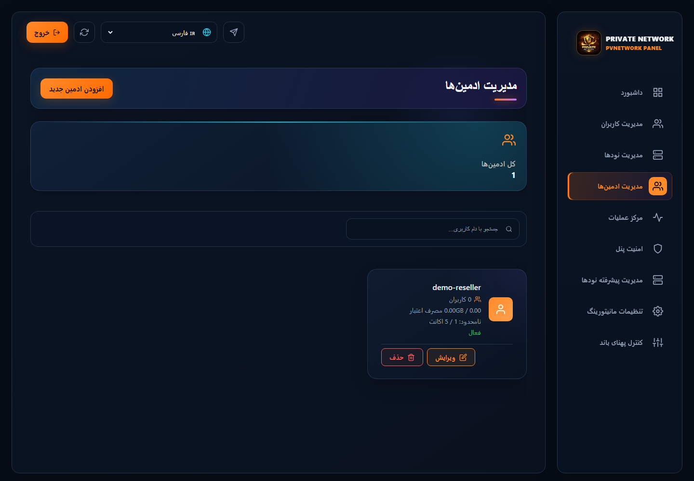

1. با مدیر اصلی، **مدیریت ادمین‌ها ← افزودن ادمین جدید** را باز کنید.
2. نام، رمز خصوصی، سهمیه ترافیک محدود و تعداد حساب نامحدود را وارد کنید. گزینه انتقال کاربران/ظرفیت موجود در فرم را پیش از ثبت بخوانید.
3. فعال بودن حساب و مصرف را بررسی و جدا با همان نماینده وارد شوید تا دامنه محدود دسترسی را کنترل کنید.
4. ظرفیت را آگاهانه ویرایش کنید. قبل از حذف نماینده، مالکیت را بخوانید و کاربران را از عملیات پشتیبانی‌شده منتقل کنید؛ انتقال یا حذف خودکار همه چیز را فرض نکنید.

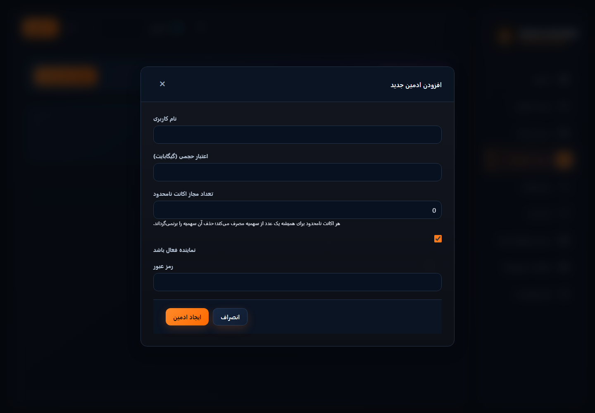

[موبایل: نمایندگان](images/v1.0.54/fa/mobile/admins.png) · [ساخت](images/v1.0.54/fa/mobile/admin-create.png)

## ۶. مرکز عملیات

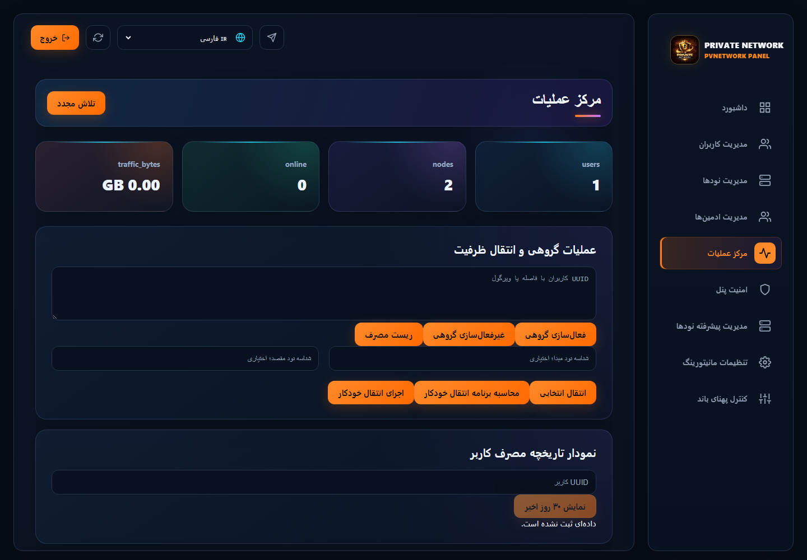

1. نمای کلی را تازه کنید و دامنه کاربران و نودهای قابل مدیریت را بررسی کنید.
2. برای عملیات گروهی، UUID هر هدف را در یک خط بنویسید. فهرست را بخوانید و فعال‌سازی، غیرفعال‌سازی یا ریست مصرف را انتخاب کنید. هدف خالی یا اشتباه را پیش از ثبت اصلاح کنید.
3. در انتقال مالکیت/ظرفیت، مبدأ، مقصد و مقدار را انتخاب و نتیجه هر دو طرف را کنترل کنید.
4. ابتدا **محاسبه پیشنهاد توازن** را اجرا کنید. تخصیص پیشنهادی و سلامت مقصد را ببینید و سپس **اجرای توازن** را بزنید. پیش‌نمایش، اجرای تغییر نیست.
5. برای تاریخچه مصرف کاربر را انتخاب و برای فهم عامل، هدف و نتیجه، audit را بررسی کنید. شکست جزئی را با نتیجه/job پیگیری کنید؛ همه اهداف را کورکورانه دوباره اجرا نکنید.

[نمای موبایل](images/v1.0.54/fa/mobile/operations.png)

## ۷. امنیت پنل

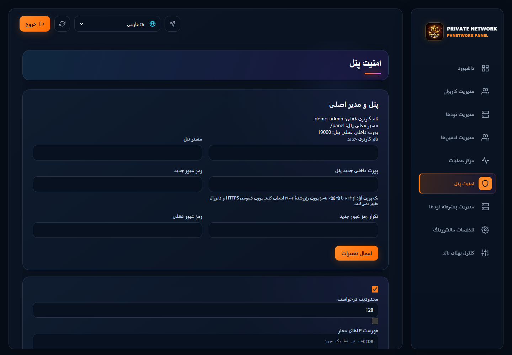

### اطلاعات ورود، مسیر و پورت

1. در **پنل و ادمین اصلی** کاربر، مسیر و پورت فعلی را بخوانید. فقط فیلد موردنظر را تغییر دهید؛ رمز تازه را تأیید و رمز فعلی را وارد کنید.
2. خلاصه را بررسی و تأیید کنید. worker پیش از تعویض تنظیمات پنل، build و canary خصوصی را بررسی می‌کند.
3. پیشرفت را تا نتیجه تأییدشده دنبال کنید؛ سپس از آدرس بازگشتی استفاده و در صورت نیاز دوباره وارد شوید. هدایت مسیر قدیم مهلت محدود دارد؛ نشانک را عوض کنید.
4. در شکست، وضعیت job/recovery را بخوانید. برای اجبار نتیجه `.env` را دستی تغییر ندهید و سرویس‌های دیگر را restart نکنید. [کنسول](CLI.fa.md) روند پشتیبانی‌شده را توضیح می‌دهد.

### سیاست دسترسی، TOTP و توکن

1. کنترل ورود و rate limit را بررسی کنید. پیش از فعال کردن allowlist، آدرس/CIDR واقعی مدیریت خودتان را وارد و راه بازیابی مدیریتی مستقل را حفظ کنید.
2. **راه‌اندازی TOTP** را آغاز، secret را خصوصی اسکن و یک کد جاری authenticator را تأیید کنید. اگر کد بازیابی ارائه شد آن را خصوصی نگه دارید؛ شروع بدون تأیید به معنی فعال شدن نیست.
3. توکن API را با حداقل scope لازم بسازید، مقدار نمایش‌داده‌شده را خصوصی ذخیره و فقط عملیات مجاز را تست کنید. توکن بدون استفاده را لغو کنید.
4. برای غیرفعال کردن TOTP، کد معتبر فعلی بدهید. نتیجه را پس از Refresh و در audit بررسی کنید.

صفحه اسکرول دارد؛ تصویر دسکتاپ ابتدای تنظیمات است. [نمای کامل موبایل](images/v1.0.54/fa/mobile/security.png) کنترل‌های پایین را هم دارد. رمز، secret و QR واقعی را منتشر نکنید.

## ۸. مدیریت پیشرفته نود

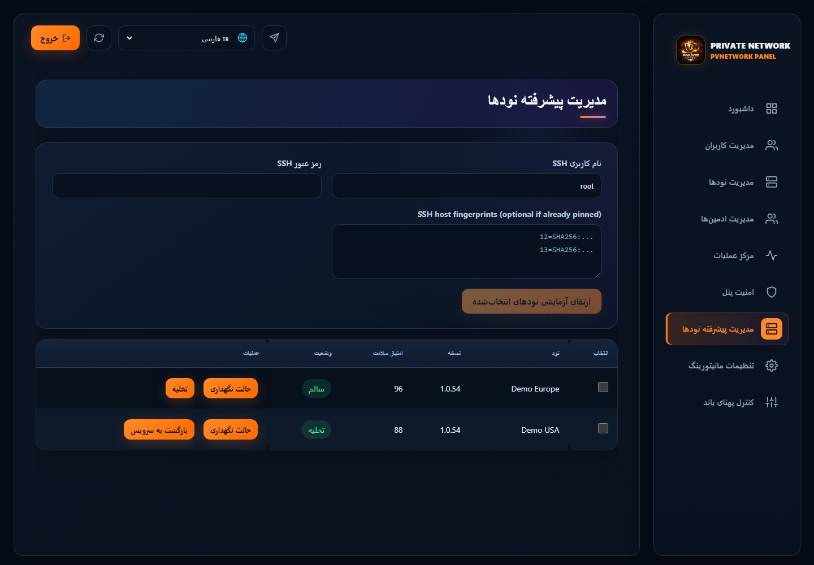

1. پیش از ارسال تعمیر، mode، نسخه، امتیاز سلامت، وضعیت و job فعال نود را ببینید.
2. اطلاعات SSH را خصوصی بدهید و برای اعتماد جدید، fingerprint میزبان را از مسیر مستقل بررسی کنید.
3. ابتدا یک نود واجد شرایط را canary ارتقا دهید. مرحله‌ها و نتیجه نهایی هر job را بخوانید؛ پذیرفته شدن به معنی تکمیل نیست.
4. drain/maintenance با ارتقای کد agent فرق دارد. ارتقای کد باید VPN جاری، کلید و شمارنده مصرف را حفظ کند؛ بعد از job این موارد را بررسی کنید.
5. در شکست یا قطع عملیات، recovery/rollback همان job را ببینید. شروع پیاپی ارتقا می‌تواند وضعیت بازیابی را مبهم کند.

[نمای موبایل](images/v1.0.54/fa/mobile/fleet.png) · [جزئیات نود native](NODE-CANDIDATE.fa.md)

## ۹. مانیتورینگ

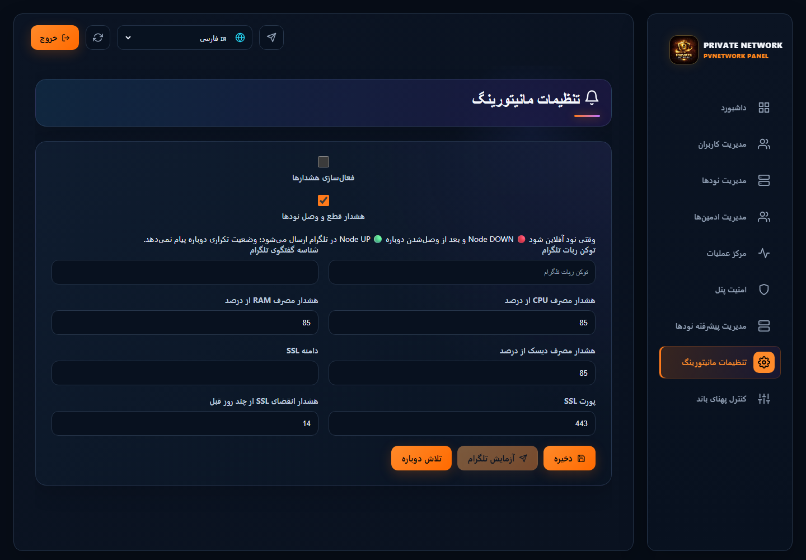

1. CPU، RAM، دیسک، مهلت هشدار SSL و نام دستگاه دیسک را بخوانید. مقدارها را با واحد نمایش‌داده‌شده و نیاز میزبان تنظیم کنید.
2. اگر Telegram لازم است، توکن ربات و chat مقصد را خصوصی وارد کنید. تا تأیید مقصد، اعلان را خاموش نگه دارید.
3. ذخیره و دوباره بارگیری کنید تا ثبت تنظیمات مشخص شود. خالی بودن توکن در فرم بعدی لزوماً پاک شدن آن نیست؛ توضیح فرم را بخوانید.
4. دکمه **تست Telegram** پیام واقعی ارسال می‌کند. فقط پس از تأیید مقصد آن را بزنید و سپس اعلان موردنظر را فعال کنید.
5. بعد از هشدار، علت سلامت/منبع را بررسی کنید؛ اعلان خودکار میزبان را تعمیر نمی‌کند.

[نمای موبایل](images/v1.0.54/fa/mobile/monitoring.png)

## ۱۰. کنترل پهنای باند

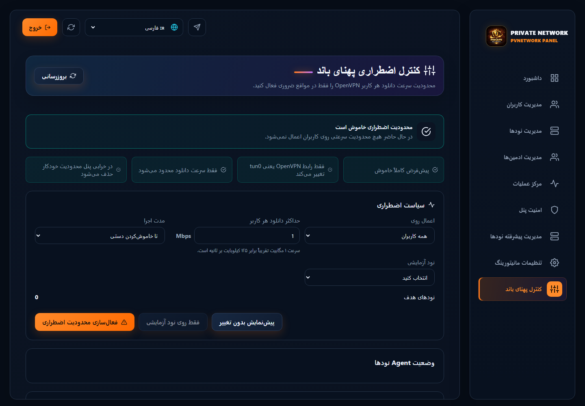

1. وضعیت محدودیت اضطراری فعلی را بخوانید. نوع هدف، کاربر/مالک/گروه، نودها و سقف دانلود را با واحد فرم مشخص کنید.
2. **پیش‌نمایش بدون تغییر** را اجرا و هدف محاسبه‌شده و نود ردشده/آفلاین را بررسی کنید.
3. یک نود canary انتخاب و **فقط canary را فعال** کنید. ترافیک هدف و بی‌تأثیر بودن کاربران دیگر را بسنجید.
4. تنها پس از نتیجه قابل‌قبول canary محدودیت گسترده‌تر را فعال و وضعیت هر نود و شکست‌ها را بررسی کنید.
5. **خاموشی اضطراری** سیاست اضطراری متعلق به پنل را برمی‌دارد. سپس ترافیک و سلامت را کنترل کنید. این دکمه reset عمومی فایروال نیست.

[نمای موبایل](images/v1.0.54/fa/mobile/bandwidth.png)

## ۱۱. بکاپ و بازیابی پنل

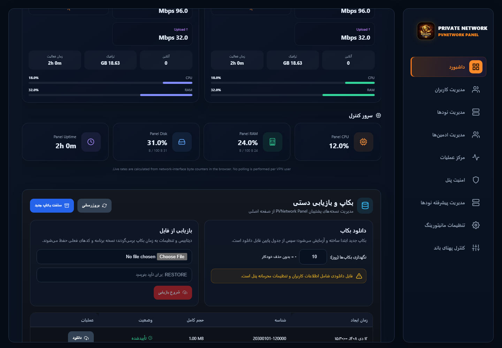

1. در پایین داشبورد **بکاپ جدید** را بزنید، منتظر نتیجه بمانید و فهرست را تازه کنید. فایل را فقط در محل خصوصی دانلود کنید.
2. خروجی وب و بکاپ native بازیابی بحران قالب متفاوت دارند؛ Restore متناظر را به کار ببرید. `sudo pvnetwork backup --json` snapshot و rehearsal واقعی دیتابیس و checksum را بررسی و مسیر بکاپ تأییدشده را اعلام می‌کند.
3. در Restore وب، فایل خصوصی سازگار را انتخاب و **RESTORE** را دقیق طبق فرم بنویسید. پیش از شروع، عملیات و اثر موردانتظار روی سرویس را بخوانید.
4. شناسه job را نگه دارید و پیشرفت را تا پایان دنبال کنید. در قطع عملیات از recovery پشتیبانی‌شده استفاده کنید؛ Restore دوم یا جایگزینی دستی فایل دیتابیس انجام ندهید.
5. پس از پایان، هویت حساب‌ها، تخصیص‌ها، سلامت محلی/عمومی و یک روند کاربری را بررسی کنید. نسخه خصوصی خارج از میزبان داشته باشید و بازیابی را دوره‌ای در محیط جدا تمرین کنید.

بکاپ native نسخه 1.0.55 فقط `data/app.log` تشخیصی را از snapshot قابل‌بازیابی کنار می‌گذارد و لاگ زنده را حفظ می‌کند. ثبات بایت کلیدها، اعتماد SSH و بقیه فایل‌ها همچنان لازم است. پوشه failed/unverified نقطه rollback معتبر نیست.

[نمای موبایل](images/v1.0.54/fa/mobile/panel-backup.png) · [ارتقا و rollback](UPDATES.md) · [کنسول ۲۵بخشی](CLI.fa.md)

## ۱۲. رفع اشکال و شواهد

| نشانه | اقدام اول | پیش از تکرار بررسی کنید |
| --- | --- | --- |
| تغییر مسیر/ورود | نتیجه تنظیمات و URL بازگشتی را بخوانید | سلامت پنل و اطلاعات جاری |
| فهرست دانلود خالی | تخصیص فعال و خطای فهرست نود را ببینید | نود قدیمی یا آفلاین نباشد |
| نود آفلاین | سلامت و job محدود؛ Doctor فقط‌خواندنی | اعتماد SSH، CA/binding و سرویس |
| job صف/در انتظار | همان شناسه را بررسی کنید | نتیجه نهایی تأییدشده |
| رد بکاپ | تشخیص خصوصی و فایل در حال تغییر را بخوانید | marker و checksum معتبر؛ نه صرف وجود پوشه |
| قطع ارتقا | jobs و recover پشتیبانی‌شده را ببینید | سلامت و نتیجه پایدار بازیابی |
| نرخ نمایش داده نمی‌شود | چند نمونه متوالی صبر کنید | زمان تازه شمارنده و دسترس‌پذیری نود |

از `sudo pvnetwork status --json`، `doctor --json`، `logs --lines 100 --json` و `jobs --json` شروع کنید. فقط پس از تشخیص، تعمیر محدود اجرا کنید. [کنسول](CLI.fa.md) دستورها و [گزارش اعتبارسنجی](VALIDATION-v1.0.54.md) شواهد و محدودیت واقعی را دارد. پیش از ثبت issue همه اطلاعات حساس و داده مشتری را حذف کنید.

### منشأ تصاویر

۸۰ تصویر تازه شامل ۲۰ نما × فارسی/انگلیسی × دسکتاپ/موبایل است. `frontend/tests/capture-current-docs.mjs` روی preview اختصاصی loopback و `capture-subscription-docs.mjs` روی قالب واقعی Jinja با داده ساختگی آن‌ها را تولید می‌کنند. درخواست HTTP خارجی مسدود است. عرض دسکتاپ ۱۴۴۰ و موبایل ۳۹۰ پیکسل است؛ این مجموعه مستندسازی جای ماتریس کامل responsive/accessibility نیست.
