# PVNetwork illustrated operator manual

[فارسی](UI-GUIDE.fa.md) · [README](../README.md) · [Install](INSTALLATION.md) · [CLI](CLI.md)

This guide follows the current v1.0.54 interface, also used by v1.0.55. Every image is a synthetic Demo capture: English/light and Persian/dark, desktop and phone. Buttons described below can change live state when used on your installation; the screenshots themselves performed no deployments, notifications or customer mutations. Main-admin sections may be hidden from reseller accounts.

## 1. Dashboard and navigation

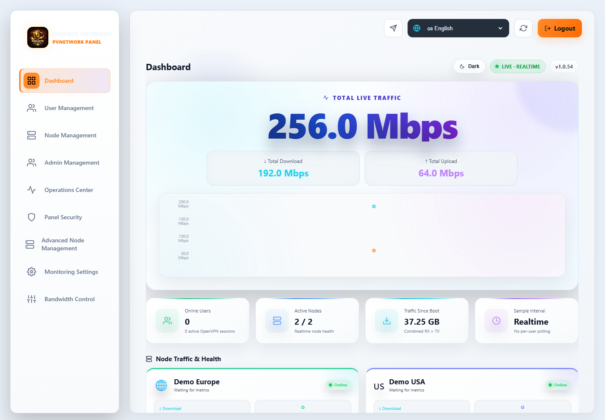

1. Sign in at the panel path returned by your installation. On a phone, use the navigation/menu control to open the required page.
2. Choose the language and theme in the header. Refresh to obtain current measurements; wait for multiple samples before interpreting rates.
3. Read **Total Live Traffic** as combined download/upload rate derived from counter deltas. **Traffic Since Boot** is cumulative bytes, not Mbps. A missing first rate sample is not zero total traffic.
4. Compare online users/sessions with each node's availability, CPU, RAM, uptime and traffic. Investigate unavailable/stale nodes before creating new assignments.
5. Scroll to the panel backup area for backup controls. Use the section below before a restore.

Expected: reachable nodes and recent samples agree with your inventory. An API error or stale sample needs investigation; it does not prove the VPN service stopped.

[Phone view](images/v1.0.54/en/mobile/dashboard.png)

## 2. Users

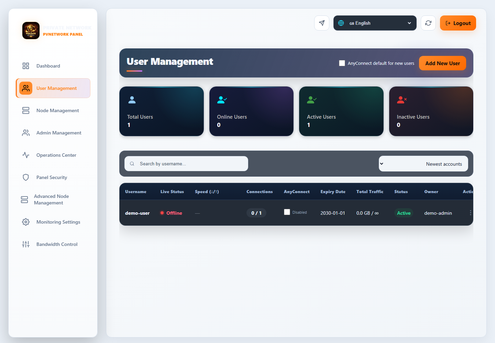

### Create an account

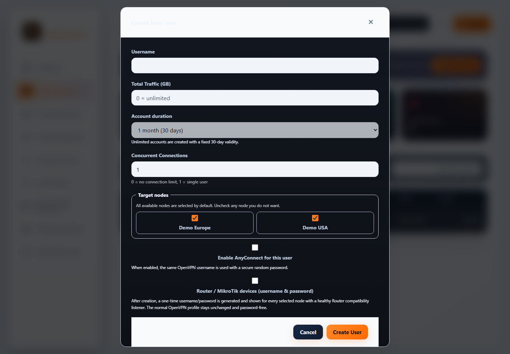

1. Open **User Management → Add New User** and enter the name, traffic quota, duration and concurrent-device limit.
2. A traffic quota of **0** denotes unlimited traffic; its baseline period is 30 days. Review duration and device policy rather than assuming unlimited means no expiry or no device limit.
3. Review **Target nodes**. Available nodes are initially selected; uncheck unwanted nodes. Offline, draining or maintenance nodes may be visible but cannot receive a new assignment.
4. Enable AnyConnect or Router/MikroTik only if you intend to provision that capability and have prepared the matching service. Create the user once and wait for the result.
5. Search for the account and check quota, expiry, state and assignments. If provisioning reports an error, inspect the account/job before submitting again.

### Quick edit, full edit and reset

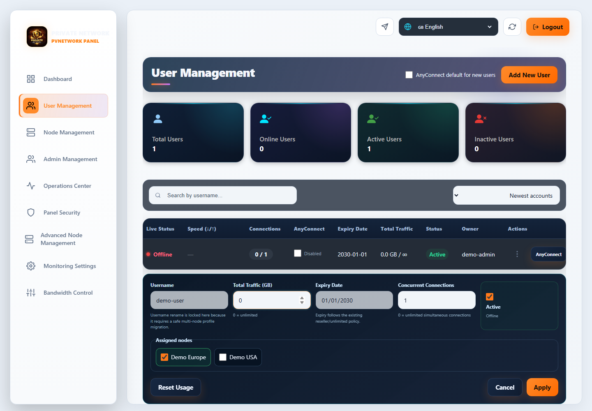

1. Open the user's action menu and choose **Quick Edit**. On a phone this opens a full-width editor below the table, so scroll to its controls.
2. Change traffic, expiry where policy allows, concurrent connections, active state or assigned nodes. Select **Reset Usage** only when a reset is intended; unlimited reset starts a fresh 30-day period.
3. **Apply** submits the changes; **Cancel** discards the open form. Re-read the resulting row after completion.
4. Use the full Edit/rename workflow for a name change. A successful rename preserves UUID but invalidates old profiles immediately; download replacements. Inspect `cleanup_pending` rather than repeating rename when remote cleanup is pending.

Removing an assignment deactivates that node's profile; it is distinct from deleting a user. Newly selected unavailable nodes are rejected before mutation.

### Renew, deactivate and delete

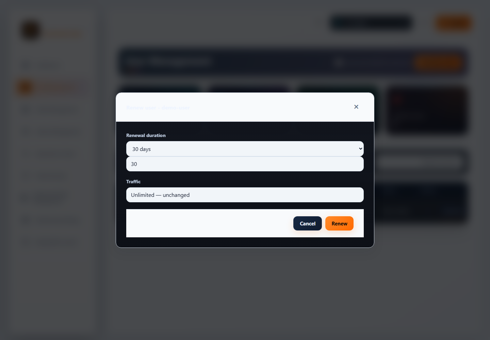

1. Choose **Renew** and review the duration and traffic mode: preserve existing usage, reset usage or add traffic where supported.
2. Submit once. Renewal keeps UUID, name and assignments; an expired account can be reactivated and synchronized.
3. To suspend access, deactivate the selected account and confirm its resulting state. Test the target account and verify unrelated users remain available.
4. Delete only after checking the selected identity and assignments. Deletion is not a reversible suspension; use deactivate when temporary access removal is intended.

### Domain history

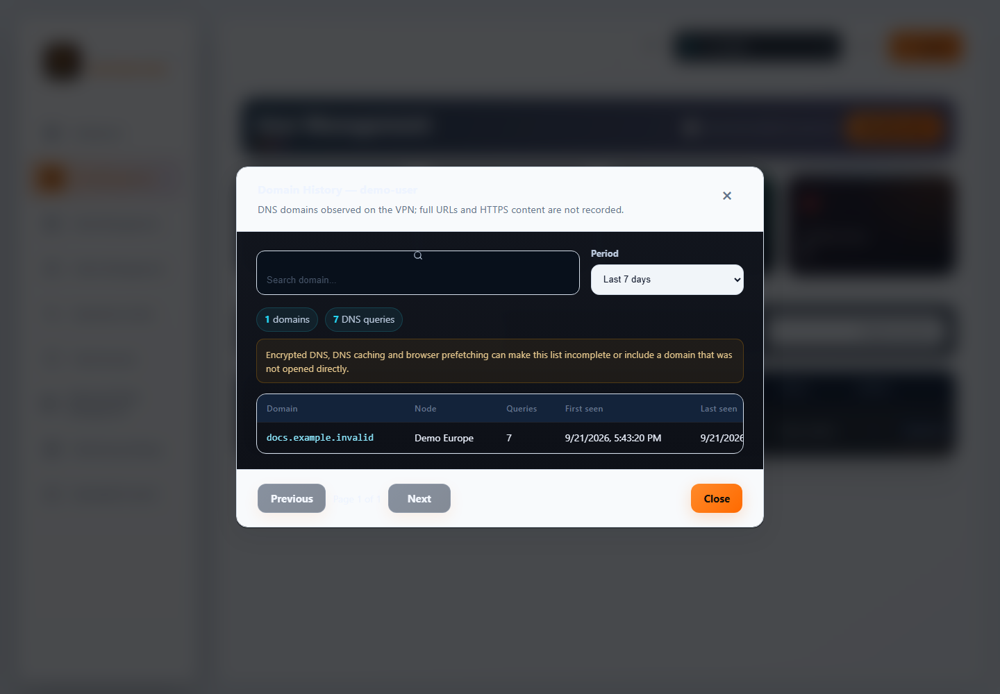

1. As main admin, choose **Domain History** from the user menu.
2. Select the period, filter and page through recorded rows. Compare the node, timestamps and hit count.
3. Treat this as recorded telemetry only; it is not a complete traffic history and does not inspect HTTPS payload contents. An empty table may mean no records in the selected window.

[Phone: users](images/v1.0.54/en/mobile/users.png) · [create](images/v1.0.54/en/mobile/user-create.png) · [quick edit](images/v1.0.54/en/mobile/quick-edit.png) · [renew](images/v1.0.54/en/mobile/user-renew.png) · [history](images/v1.0.54/en/mobile/domain-history.png)

## 3. Profiles, subscriptions and AnyConnect

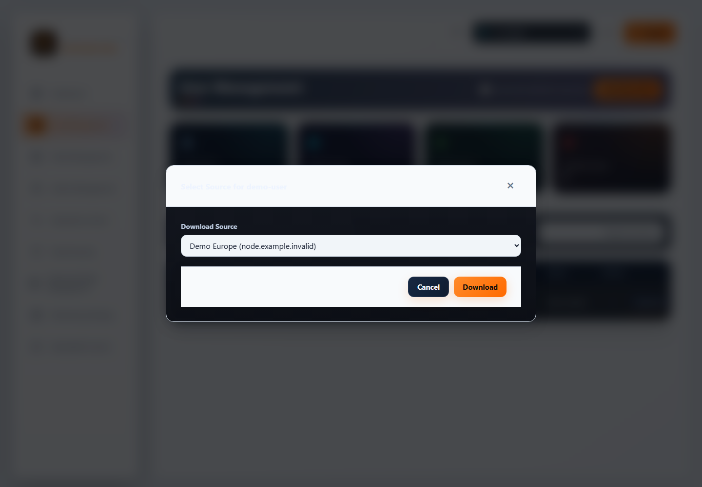

1. Choose **Download** for the intended user and review the node. The initially selected node is usable without reselecting it; an explicit selection downloads that node's profile.
2. Save the `.ovpn` file privately, import it into a compatible OpenVPN client and connect. Verify successful TLS/TUN connection and useful traffic, then check usage/presence in the panel.
3. Use **Copy Link** to open the user's subscription page. A subscription URL/QR/profile grants access information: share it only with that user.
4. On the subscription page, inspect status, usage, expiry and device allowance, then choose an available assigned node. Use the client download/import instructions shown for the chosen platform. Keyboard users can focus and activate QR actions with Enter/Space.
5. If a browser offers PWA installation or notifications, enable them only on a trusted device. Missing install/notification controls can depend on HTTPS, browser permissions and platform support.

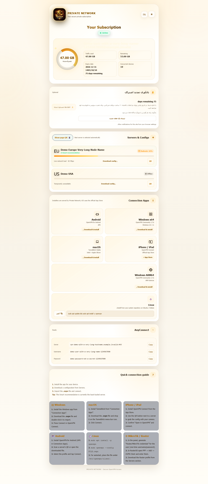

The screenshot contains explicitly synthetic AnyConnect credentials. Your real subscription page is private. A recommended/online badge is selection guidance, not proof that your ISP path can connect.

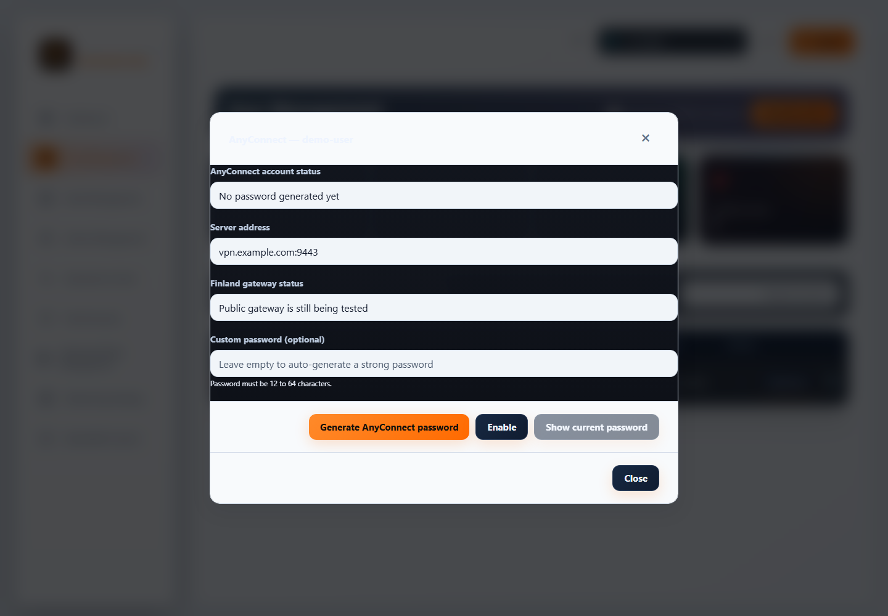

1. Open **AnyConnect** on the existing user. Confirm the intended server and account state.
2. Enable the account or generate/change a password only as needed. Revealing a current password requires the dialog's explicit action.
3. Transfer the credentials privately and test the supported AnyConnect service separately. This does not provision an arbitrary external VPN server just by opening the dialog.

Router/MikroTik access is opt-in. Select it when creating/configuring the account, use its assigned compatible node and import the appropriate profile into your router. Test protocol/cipher support, routes and traffic on a test router before deploying it to a working network.

[Phone: profile chooser](images/v1.0.54/en/mobile/profile-download.png) · [subscription](images/v1.0.54/en/mobile/subscription.png) · [AnyConnect](images/v1.0.54/en/mobile/anyconnect.png)

## 4. Nodes

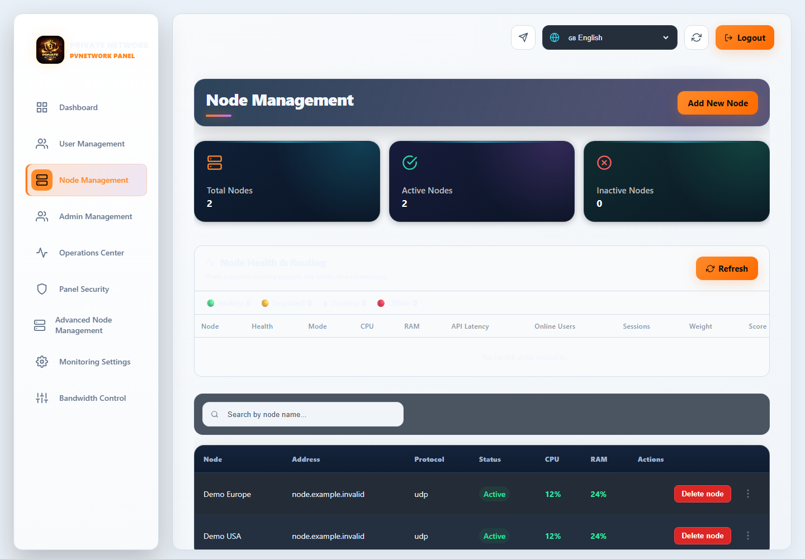

1. Open **Node Management** and inspect the inventory, address, active state and health. Refresh health separately if the row appears stale.
2. To add a host, follow the [node installation tutorial](NODE-INSTALLATION.md). Choose fresh, explicit adopt or manual registration deliberately.
3. After a deployment is accepted, follow its job to verified completion. Confirm authenticated HTTPS node health and registration, then use a test user to verify profile creation and actual VPN traffic.
4. Drain a node before maintenance when appropriate: this stops new allocations; it does not imply existing sessions have ended. Reconcile/repair is scoped to the registered node and preserves assignments.
5. Before removal, review users and capacity. Last-node/assignment guards can refuse the action. Move assignments through a reviewed workflow rather than deleting a live node to bypass a failure.

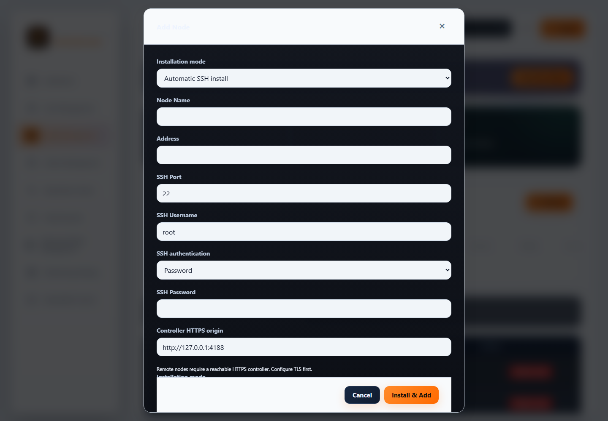

### Node archives

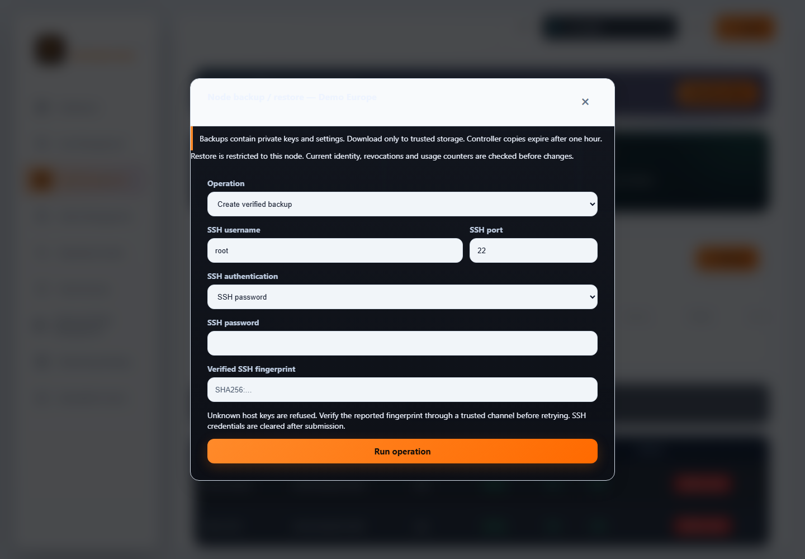

1. Open **Node backup / restore** for the intended node and choose the exact operation.
2. Supply independently verified SSH trust and private authentication. For restore, read the archive/recovery requirements in [node archives](NODE-ARCHIVES-CANDIDATE.md).
3. Execute once and retain the private archive and job ID. Confirm the terminal result, node binding and VPN/accounting health. A panel backup and a node archive cover different state.
4. If interrupted, inspect the owned recovery job before starting a second restore. Never apply an archive to a different node merely because its address is reachable.

[Phone: inventory](images/v1.0.54/en/mobile/nodes.png) · [add](images/v1.0.54/en/mobile/node-create.png) · [archive](images/v1.0.54/en/mobile/node-archive.png)

## 5. Admins and resellers

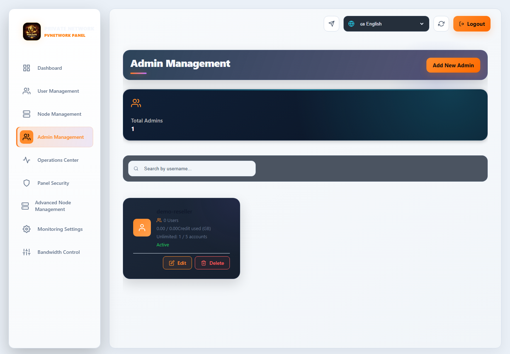

1. As main admin, open **Admin Management → Add New Admin**.
2. Enter the username, private password, finite traffic quota and allowed unlimited-account count. The create form can transfer existing users/capacity according to its displayed option; read it before submitting.
3. Confirm the account's active state and usage, then sign in separately as that reseller to verify the intended limited scope.
4. Edit capacity deliberately. Before removing a reseller, review ownership and transfer users through the supported operation instead of assuming removal deletes or safely reassigns everything.

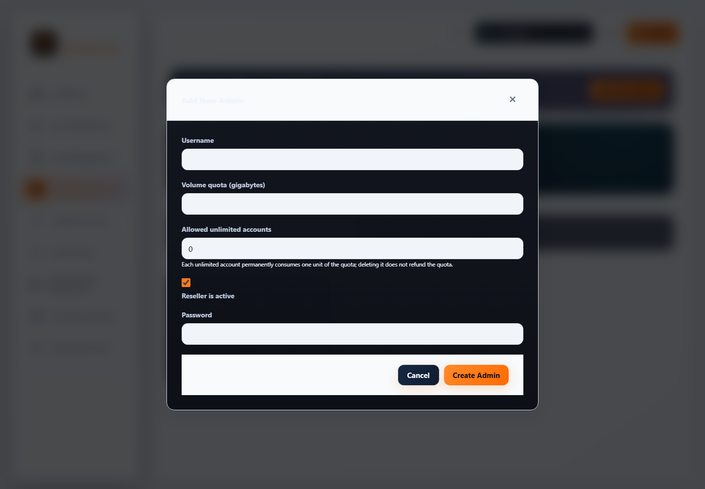

[Phone: admins](images/v1.0.54/en/mobile/admins.png) · [create](images/v1.0.54/en/mobile/admin-create.png)

## 6. Operations Center

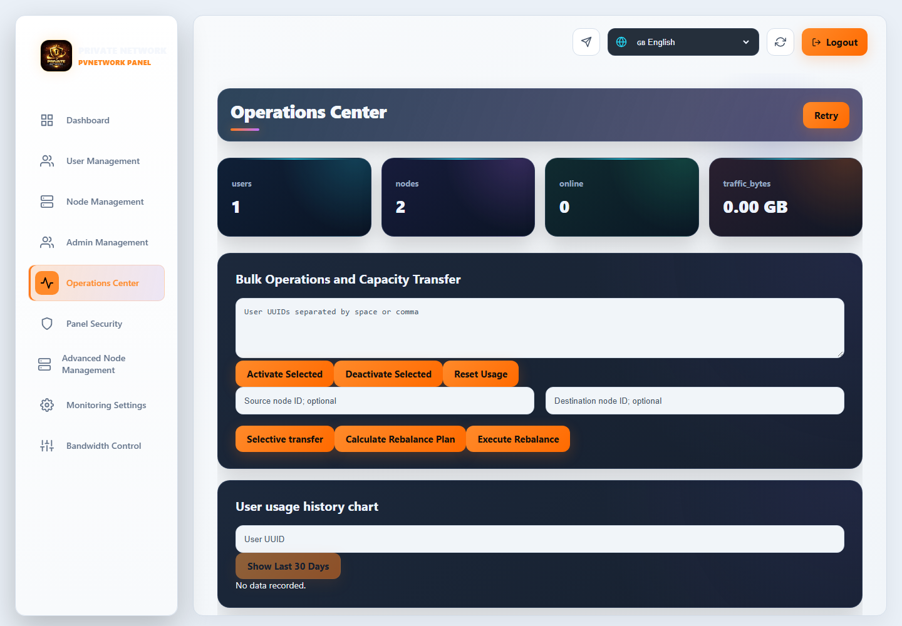

1. Refresh the overview and verify which users/nodes your account may manage.
2. Enter one intended user UUID per line for a bulk action. Review the list and choose activate, deactivate or reset usage. An empty/mistyped selection must be corrected before submission.
3. For ownership/capacity transfer, select source/destination and the intended amount, then verify both sides afterward.
4. Use **Calculate Rebalance Plan** first. Review proposed assignments and destination health before **Execute Rebalance**. A preview is not execution.
5. Select a user for usage history, and inspect audit records to understand an operation's actor, target and result. Report partial failures with their job/result rather than blindly repeating all targets.

[Phone view](images/v1.0.54/en/mobile/operations.png)

## 7. Panel Security

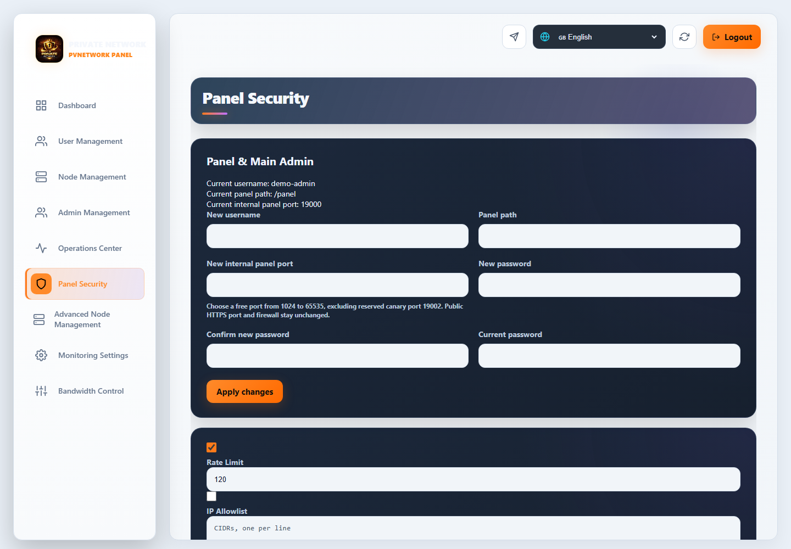

### Panel credentials, path and port

1. In **Panel & Main Admin**, review the current user/path/port. Enter only the intended new fields, confirm a new password when applicable and provide the current password.
2. Review and confirm the change. The worker builds and checks a private canary before switching the selected panel settings.
3. Follow the progress until verified, then use the returned address and sign in again as needed. The old-path redirect has a limited grace period; update your bookmark.
4. On failure, read the job/recovery state; do not edit `.env` or restart unrelated services to force completion. [CLI settings and recovery](CLI.md) explains the supported operations.

### Access policy, TOTP and tokens

1. Review the login/rate-limit controls. Before enabling an IP allowlist, include your actual current management address/CIDR and keep an independent administrative recovery path.
2. Begin **TOTP setup**, scan the secret privately and confirm a current authenticator code. Store any recovery codes privately if offered; do not assume an unconfirmed setup is enabled.
3. Create API tokens with the smallest required scopes. Save the displayed secret privately, exercise only the allowed API operations and revoke unused tokens.
4. Use a valid current code for TOTP disable. Refresh to verify the resulting state and use the audit trail to inspect changes.

The page is scrollable; the first screenshot shows its upper settings area. [Full phone view](images/v1.0.54/en/mobile/security.png) includes the lower access controls. Never publish its real secrets or QR image.

## 8. Advanced Node Management

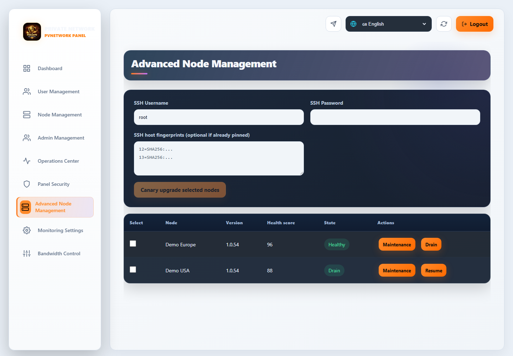

1. Inspect node mode, version, health score, state and active job before submitting maintenance.
2. Enter SSH authentication privately and verify the host fingerprint independently for a new trust relationship.
3. Use a canary upgrade on one eligible node before wider execution. Inspect each job's stages and terminal result; acceptance is not completion.
4. Drain/maintenance and agent code upgrade have different scopes. Code upgrade should preserve the running VPN, keys and current accounting; verify those properties after the job.
5. If a job fails or was interrupted, inspect recovery/rollback for that owned job. Repeatedly launching upgrades can obscure the recovery state.

[Phone view](images/v1.0.54/en/mobile/fleet.png) · [Native node details](NODE-CANDIDATE.md)

## 9. Monitoring

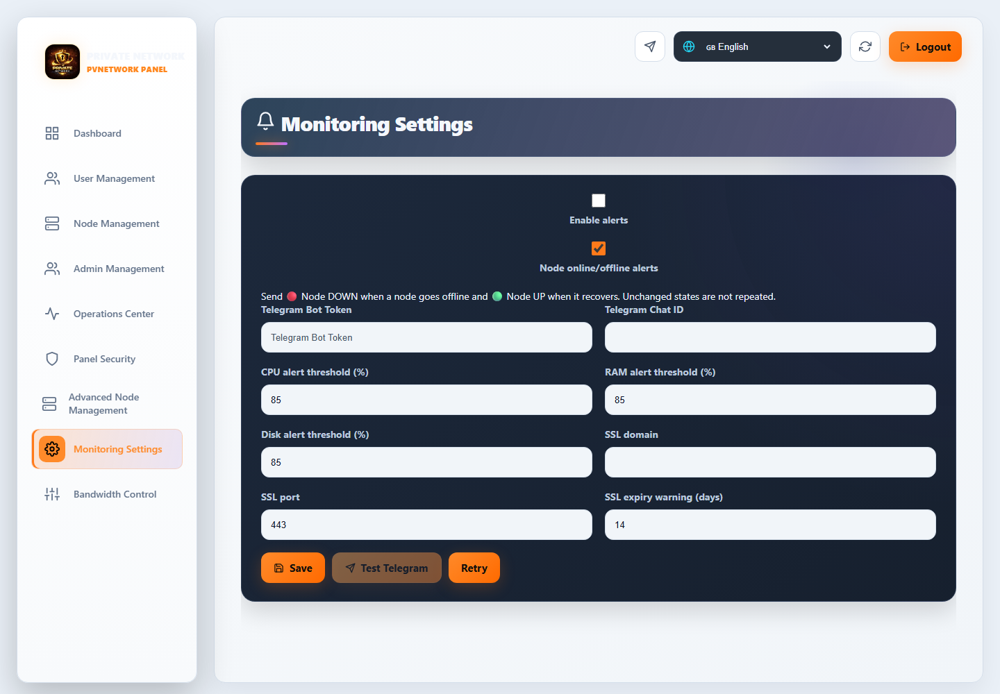

1. Review CPU, RAM, disk, SSL-warning and disk-device fields. Choose thresholds appropriate to your host and units shown in the form.
2. If Telegram is desired, enter the bot token and destination chat privately. Keep notifications disabled until the destination is correct.
3. Save, reload and confirm the persisted settings. A token omitted from a later form is not necessarily cleared; follow the form's guidance.
4. **Test Telegram** sends a real message when you click it. Use it only after verifying the destination, then enable intended alerts.
5. Investigate the underlying health/resource condition after an alert. Notifications do not automatically repair the host.

[Phone view](images/v1.0.54/en/mobile/monitoring.png)

## 10. Bandwidth Control

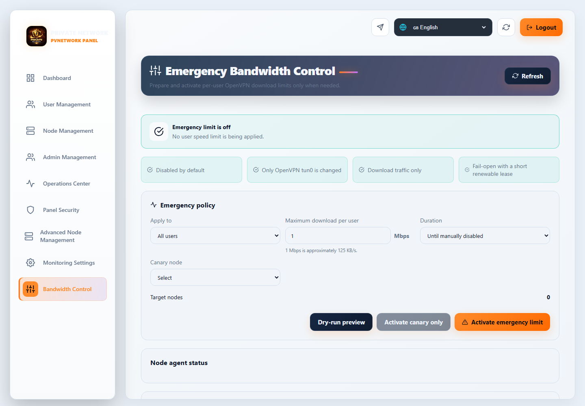

1. Read the current emergency-limit state. Select the intended target type, users/owner/group, nodes and download limit using the displayed units.
2. Run **Dry-run preview** and inspect the calculated targets and any rejected/unavailable nodes.
3. Select a canary node and **Activate canary only**. Measure the target's traffic and verify unrelated users remain unaffected.
4. Activate the wider emergency limit only after the canary result is acceptable. Inspect per-node status and failures.
5. Use **Emergency Off** to remove the owned emergency policy, then verify traffic and node status. It is not a general firewall reset.

[Phone view](images/v1.0.54/en/mobile/bandwidth.png)

## 11. Panel backup and restore

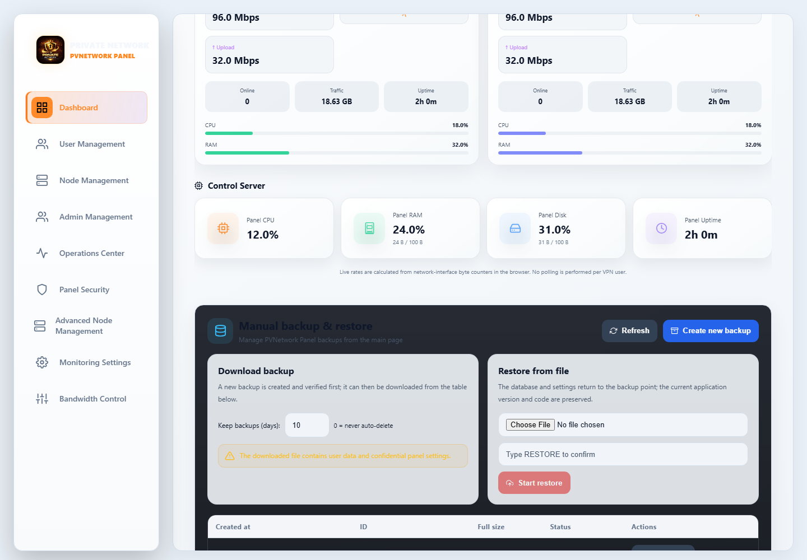

1. On Dashboard, open the backup area and **Create new backup**. Wait for its result and refresh the list. Download only to private storage.
2. Treat web exports and native disaster-recovery backups as distinct formats; use the matching restore operation. Native `sudo pvnetwork backup --json` performs database-native snapshot/restore rehearsal and checksum checks and reports a verified backup path.
3. For web restore, choose the compatible private backup and enter the exact **RESTORE** confirmation required by the form. Read the selected operation and expected service impact before starting.
4. Keep the job ID and follow progress until completion. If interrupted, use the supported recovery flow rather than launching another restore or replacing database files manually.
5. Verify account identities, node assignments, local/public health and an intended user workflow afterward. Keep a private off-host copy and periodically rehearse restore in an isolated environment.

Native v1.0.55 excludes the append-only panel diagnostic `data/app.log` from restorable snapshots; it leaves the live log intact. Keys, SSH trust and other files still require stable bytes. Failed/unverified backup directories are not valid rollback points.

[Phone view](images/v1.0.54/en/mobile/panel-backup.png) · [Update/rollback](UPDATES.md) · [25-item CLI](CLI.md)

## 12. Troubleshooting and evidence

| Symptom | First action | Verify before retry |
| --- | --- | --- |
| Login/path changed | Read the verified settings result and returned URL | Panel health and current credentials |
| Profile chooser empty | Check assigned active nodes and the node-list error | No stale/unavailable assignment |
| Node offline | Inspect health and scoped job; run read-only Doctor | SSH trust, HTTPS CA/binding and service state |
| Job queued/pending | Inspect that job ID | A terminal verified result |
| Backup refused | Read the private diagnostic; check changing keys/state | Verified marker/checksums, not directory existence |
| Update interrupted | Inspect `jobs`; use supported `recover` | Health and durable recovery result |
| Rates absent after load | Wait for successive samples | Fresh counter timestamps and reachable node |

Start with `sudo pvnetwork status --json`, `doctor --json`, `logs --lines 100 --json` and `jobs --json`. Run only a scoped repair after diagnosis. Use [CLI](CLI.md) for syntax and [validation](VALIDATION-v1.0.54.md) for actual evidence/limitations. Redact all secrets and customer data before opening an issue.

### Screenshot provenance

80 fresh captures cover 20 views × English/Persian × desktop/phone. Reproduce with `frontend/tests/capture-current-docs.mjs` against an owned loopback preview and `capture-subscription-docs.mjs` against the real Jinja template with synthetic fixtures. The browser aborts external HTTP requests. Desktop images are 1440 px wide, phones 390 px; screenshots are a documentation set, not the full responsive/accessibility acceptance matrix.
